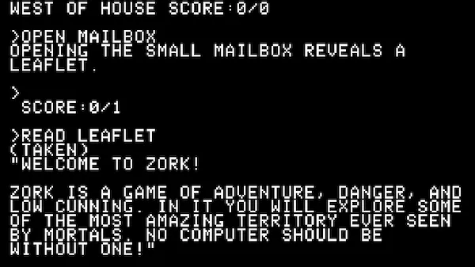

> WELCOME TO ELIXIR!
>
> ELIXIR is a language of adventure, danger, and low cunning. In it you will explore some of the most amazing territory ever seen by mortals. No computer should be without one!

An introduction to Elixir in eight pages: processes, the BEAM, immutable data, GenServers, pattern matching, and recursion. Each page was written as a Livebook first, so you can [run the code as you read](https://github.com/sdball/livebooks/tree/main/books/strange-leaflet-about-elixir).
