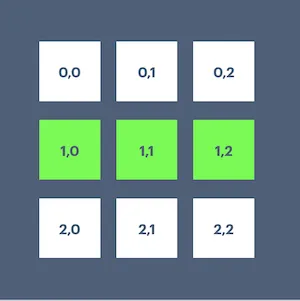
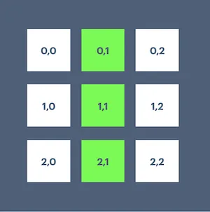
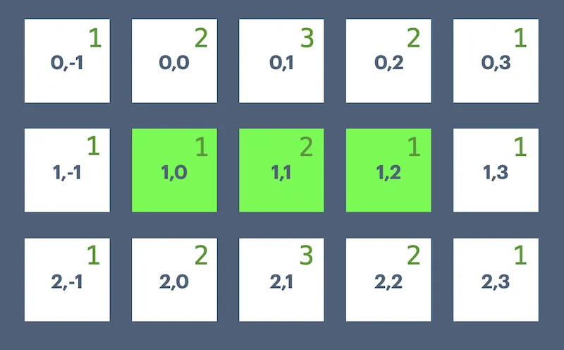

## Context: What is Conway's Game of Life?

It might help to play with a [working Game of Life implementation](https://curious.strangeleaflet.com/conway-life/) first.

The Game of Life is a mathematical game / life simulation invented by John Conway in 1970.

It consists of an infinite 2d board made up of squares, called cells. The cells can be alive or dead (or populated/unpopulative, active/inactive, etc).

The state of every square cell is governed by its eight neighbors


- Any living cell with fewer than two living neighbors: dies
- Any living cell with two or three living neighbors: remains alive
- Any living cell with more than three neighbors: dies
- Any dead cell with exactly three neighbors: becomes alive

The game is seeded with an initial pattern and from that point the pattern plays out according to the rules.

It might seem trivial but the simple system and rules give rise to surprisingly complex living ecosystems. It's even possible to build patterns of such complexity that they can store data and perform calculations.

You can try out my own [LiveView based Game of Life](https://curious.strangeleaflet.com/conway-life/). You can try filling out a seed pattern yourself by clicking on the dead cells and then either "step" to see the next interation or "play" to play out the board. If you want a fun way to get started you can click "random" and then "play" to see how a random pattern generates interestingly lifelike behavior.

## Functional programming?

Functional programming is an excellent fit for programming the Game of Life because the game is a series of data transforms where one state is the input and the result is that transformed state. Not only functional but **pure** functional. Joy!

## Modeling the Game of Life

When modeling the Game of Life it's very common to reach for a list, array, or some other continuous data structure to hold ALL the cells, living and dead e.g. `0` for dead and `1` for alive and have the board structure match the data storage.

```
[
  [0, 0, 0],
  [1, 1, 1],
  [0, 0, 0],
]
```

That approach is certainly possible, but the supporting code is quickly bogged down in the limits of having to iterate through hundreds or thousands of empty cells depending on the size of your board.

A more flexible approach is to not model the grid itself, but only maintain a list of the living cells as a set of coordinates. With this data structure the code becomes quite simple to implement as you'll see.

> "The wrong data structure has to be supported by code. The right data structure supports the code." — Stephen Ball

If we agree that the "top" "left" of the board is row 0, column 0 then we can model the board above and its four living cells like this:

```
[{1,0}, {1,1}, {1,2}]
```

And instead of a list, since we know each cell coordinate value can only appear once, we can use a `Set` to store the values which allows for fast checking to see if any given coordinate values are present in the set of living cells.

With that approach modeling the Game of Life turns into creating some function that accepts a list/set of living cells, and returns the list/set of cells as transformed by the given rules.

Per the game rules our above example would transform (commonly called "step") like so

```
step([{1,0}, {1,1}, {1,2}])
# => [{0,1}, {1,1}, {2,1}]
```

A classic "blinker" pattern because the cells flip back and forth between the two states.

From step 1:

- {0,0} remains dead because it only has one living neighbor
- {0,1} becomes alive because it has exactly three living neighbors
- {0,2} remains dead because it only has one living neighbor
- {1,0} dies because it only has one living neighbor
- {1,1} remains alive because it has two living neighbors
- {1,2} dies because it only has one living neighbor
- {2,0} remains dead because it only has one living neighbor
- {2,1} becomes alive because it has exactly three living neighbors
- {2,2} remains dead because it only has one living neighbor




## Coding the Game of Life (Clojure)

There are many, many implementations of the Game of Life in every programming language.

But for my money, this [Game of Life implementation in Clojure by Christophe Grand](http://clj-me.cgrand.net/2011/08/19/conways-game-of-life/) is the most elegant.

```clojure
(defn neighbours [[x y]]
  (for [dx [-1 0 1] dy (if (zero? dx) [-1 1] [-1 0 1])]
    [(+ dx x) (+ dy y)]))

(defn step [cells]
  (set (for [[loc n] (frequencies (mapcat neighbours cells))
             :when (or (= n 3) (and (= n 2) (cells loc)))]
         loc)))
```

One function to calculate neighbors from a given point, another function to step a list of cells to the next iteration according to the Game of Life rules. Wonderful!

Let's see it work:

```
$ clj
```

```clojure
user=> (neighbours [2,3])
([1 2] [1 3] [1 4] [2 2] [2 4] [3 2] [3 3] [3 4])
```

Given a pair of coordinates we can calculate its neighbors.

Here's our blinker setup in data.

```clojure
#{[1 0] [1 1] [1 2]}
```

If our `step` function is correct we should end up with `#{[0 1] [1 1] [2 1]}`

And we do (in a HashSet so the printing order is arbitrary)

```clojure
user=> (step #{[1 0] [1 1] [1 2]})
#{[1 1] [2 1] [0 1]}
```

And we can complete a blink cycle by stepping once more to return to our original cells.

```clojure
user=> (step #{[1 1] [2 1] [0 1]})
#{[1 0] [1 1] [1 2]}
```

How does that compact bit of code handle all the rules? Let's break it down!

## Understanding the Clojure implementation

```clojure
(defn step [cells]
  (set (for [[loc n] (frequencies (mapcat neighbours cells))
             :when (or (= n 3) (and (= n 2) (cells loc)))]
         loc)))
```

`defn` is defining a named function called `step` which will accept a single argument of a list of `cells`

Now let's unpack the operations from right to left: ultimately we'll reach the `set` function that will generate the return value from its argument.

We have `cells` `#{[1 1] [2 1] [0 1]}`

We generate a concatenated map of all the cells neighboring each of those cells

```clojure
(mapcat neighbours #{[1 0] [1 1] [1 2]})
([0 -1] [0 0] [0 1] [1 -1] [1 1] [2 -1] [2 0] [2 1] [0 0] [0 1] [0 2] [1 0] [1 2] [2 0] [2 1] [2 2] [0 1] [0 2] [0 3] [1 1] [1 3] [2 1] [2 2] [2 3])
```

That is, we've applied the `neighbours` function to each cell `[1 0]` `[1 1]`, and `[1 2]` in turn and concatenated the results. If we were to call `map` instead of `mapcat` then we'd get a lists of neighbors for each cell in three separate results (formatted for clarity)

```clojure
user=> (map neighbours #{[1 0] [1 1] [1 2]})
(
  ([0 -1] [0 0] [0 1] [1 -1] [1 1] [2 -1] [2 0] [2 1])
  ([0 0]  [0 1] [0 2] [1 0]  [1 2] [2 0]  [2 1] [2 2])
  ([0 1]  [0 2] [0 3] [1 1]  [1 3] [2 1]  [2 2] [2 3])
)
```

`mapcat` returns that same data, but joined. Again formatted for clarity

```clojure
(mapcat neighbours #{[1 0] [1 1] [1 2]})
(
  [0 -1] [0 0] [0 1] [1 -1] [1 1] [2 -1] [2 0] [2 1]
  [0 0]  [0 1] [0 2] [1 0]  [1 2] [2 0]  [2 1] [2 2]
  [0 1]  [0 2] [0 3] [1 1]  [1 3] [2 1]  [2 2] [2 3]
)
```

Why do we want a single list? Because that's all the data we need to generate the next step of the game!

That might be a surprising result, don't we need to iterate through each cell and make a decision about its next state?

Well, no. We need to iterate through every neighbor of each of our cells and make a decision about _its_ next state. That way we also determine cells that need to become alive and not just cells that remain alive or that become dead.

If it's still confusing lets look at the frequencies data which is the next function call.

```clojure
user=> (frequencies (mapcat neighbours #{[1 0] [1 1] [1 2]}))
{[2 2] 2, [0 0] 2, [2 -1] 1, [1 0] 1, [2 3] 1, [1 1] 2, [1 3] 1, [0 3] 1, [1 -1] 1, [0 2] 2, [2 0] 2, [2 1] 3, [0 -1] 1, [1 2] 1, [0 1] 3}
```

Formatted and ordered

```
{
  [0 -1] 1,
  [0 0] 2,
  [0 1] 3
  [0 2] 2,
  [0 3] 1,
  [1 -1] 1,
  [1 0] 1,
  [1 1] 2,
  [1 2] 1,
  [1 3] 1,
  [2 -1] 1,
  [2 0] 2,
  [2 1] 3,
  [2 2] 2,
  [2 3] 1,
}
```

So we've taken our `mapcat` of all the neighbors and then counted each individual occurence of each cell.

Overlaying those results on our graphical representation might be helpful



See how the accumulated counts of all the neighbors of all the cells that are living in the current step turns into exactly the data we need to generate the next step?

If you aren't quite there consider one cell, say `[0,0]`. It has two neighbors in our first step as we can see. In other words: it was present in the list of neighbors for two of our living cells!

For each cell in consideration (neighboring a currently living cell) we're counting how many times it appears in the neighbors of currently living cells. Beautiful!

For `[0,0]` it appears in two lists so it _must_ have two living neighbors itself:

- living cell `[1,0]`: `[0,0]` is its neighbor
- living cell `[1,1]`: `[0,0]` is its neighbor
- living cell `[1,2]`: `[0,0]` is not its neighbor

So with the data structure coming from `frequencies` where we have a list of each cell and its count of neighbors we can simply apply the rules!

Let's take another look at that `step` function:

```clojure
(defn step [cells]
  (set (for [[loc n] (frequencies (mapcat neighbours cells))
             :when (or (= n 3) (and (= n 2) (cells loc)))]
         loc)))
```

We `for` loop over the `[loc n]` from the `frequencies` function where `loc` is the coordinates and `n` is the neighbors count.

In the for loop we have two conditions that will include the cell in the results:

- `n` equals `3` (exactly three neighbors brings a cell to life)
- `n` equals `2` and the cell is already in the list of cells (two neighbors keeps a living cell alive)

That's it! We don't need to explicitly express the rules for when a cell dies because, again, our elegant choice of data structure means we're **only** tracking living cells. If a cell is not in our resulting list of living cells then it is by definition a dead cell.

That list of living cells is then sent through `set` to return the same type of data structure we started with. A set of coordinates where each coordinate can explicitly only appear once.

## Translating the Clojure approach to Elixir

### Failing to for loop

Clojure is great and all, but let's see how we can express this code in Elixir! Because both languages are functional the result is largely the same, although not quite as concise in the Elixir form because Elixir `for` loops don't allow the same level of expression.

First off, the `neighbors` calculation

```elixir
def neighbors({x, y}) do
  for dx <- -1..1, dy <- -1..1, {dx, dy} !== {0, 0} do
    {dx + x, dy + y}
  end
end
```

Excellent, a straightforward port from Clojure. We loop over a set of delta calculations to find the eight neighbors for a given cell coordinates.

Now `step`.

We can _almost_ write this in Elixir, but in Elixir `when` expressions are a special type of calculation called a **guard** and guards cannot execute remote functions such as that `MapSet.member?/2` but only kernel level functions.

```elixir
def step(cells) do
  for {cell, n} when n == 3 or (n == 2 and MapSet.member?(cells, cell)) <-
        Enum.frequencies(Enum.flat_map(cells, &neighbors/1)) do
    cell
  end
end
```

We're a little closer if we try to use the `in` expression which is available in guards. But that doesn't work because guards checks must work against compile-time data and `cells` is runtime data.

```elixir
def step(cells) do
  for {cell, n} when n == 3 or (n == 2 and cell in cells) <-
        Enum.frequencies(Enum.flat_map(cells, &neighbors/1)) do
    cell
  end
end
```

If we could magically have compile-time data to check `cell` against then this works

```elixir
def step(cells) do
  for {cell, n} when n == 3 or (n == 2 and cell in [{1, 0}, {1, 1}, {1, 2}]) <-
        Enum.frequencies(Enum.flat_map(cells, &neighbors/1)) do
    cell
  end
end
```

But ah well. That code doesn't look very idiomatic in Elixir anyway. The Elixir approach is to build data pipelines that are readable top to bottom starting from an initial data structure and ending with the result. Let's do that!

### Winning with a pipeline

```elixir
def step(cells) do
  cells
  |> Enum.flat_map(&neighbors/1)
  |> Enum.frequencies()
  |> Enum.reduce(MapSet.new(), fn {cell, neighbors}, acc ->
    if neighbors == 3 or (neighbors == 2 && MapSet.member?(cells, cell)) do
      MapSet.put(acc, cell)
    else
      acc
    end
  end)
end
```

Ahh lovely. Perhaps more readable than the Clojure version if not quite as mathematically elegant.

Let's read the pipeline, each `|>` is a function that takes the data on its left and makes it the first argument to the function call on its right.

We start with our enumerable data structure of living cells

```elixir
cells
# => MapSet.new([{1, 0}, {1, 1}, {1, 2}])
```

Flat map over `neighbors` gives us the concatenated list of all neighbors of living cells.

```elixir
|> Enum.flat_map(&neighbors/1)
# [
#   {0, -1},
#   {0, 0},
#   {0, 1},
#   {1, -1},
#   {1, 1},
#   {2, -1},
#   {2, 0},
#   {2, 1},
#   {0, 0},
#   {0, 1},
#   {0, 2},
#   {1, 0},
#   {1, 2},
#   {2, 0},
#   {2, 1},
#   {2, 2},
#   {0, 1},
#   {0, 2},
#   {0, 3},
#   {1, 1},
#   {1, 3},
#   {2, 1},
#   {2, 2},
#   {2, 3}
# ]
```

Count each occurence of the cells from the list of neighbors.

```elixir
|> Enum.frequencies()
# %{
#   {0, -1} => 1,
#   {0, 0} => 2,
#   {0, 1} => 3,
#   {0, 2} => 2,
#   {0, 3} => 1,
#   {1, -1} => 1,
#   {1, 0} => 1,
#   {1, 1} => 2,
#   {1, 2} => 1,
#   {1, 3} => 1,
#   {2, -1} => 1,
#   {2, 0} => 2,
#   {2, 1} => 3,
#   {2, 2} => 2,
#   {2, 3} => 1
# }
```

Reduce that list into a `MapSet` and only include cells that have three neighbors or have two neighbors and are already in the list of living cells.

```elixir
|> Enum.reduce(MapSet.new(), fn {cell, neighbors}, acc ->
  if neighbors == 3 or (neighbors == 2 && MapSet.member?(cells, cell)) do
    MapSet.put(acc, cell)
  else
    acc
  end
end)
# => MapSet.new([{0, 1}, {1, 1}, {2, 1}])
```

All together now!

```elixir
defmodule GameOfLife do
  @moduledoc """
  Christophe Grand's implementation of Conway's Game of Life
  (http://clj-me.cgrand.net/2011/08/19/conways-game-of-life)

  Translated from Clojure to Elixir by Stephen Ball.
  """

  @doc """
  Returns the coordinates of the neighbors for a given cell: `{x, y}`
  """
  def neighbors({x, y}) do
    for dx <- -1..1, dy <- -1..1, {dx, dy} !== {0, 0} do
      {dx + x, dy + y}
    end
  end

  @doc """
  Returns the next iteration for a given list of cells.

  iex> GameOfLife.step(MapSet.new([{1, 0}, {1, 1}, {1, 2}]))
  MapSet.new([{0, 1}, {1, 1}, {2, 1}])
  """
  def step(cells) do
    cells
    |> Enum.flat_map(&neighbors/1)
    |> Enum.frequencies()
    |> Enum.reduce(MapSet.new(), fn {cell, neighbors}, acc ->
      if neighbors == 3 or (neighbors == 2 && MapSet.member?(cells, cell)) do
        MapSet.put(acc, cell)
      else
        acc
      end
    end)
  end
end
```

```elixir
iex> GameOfLife.step(MapSet.new([{1, 0}, {1, 1}, {1, 2}]))
MapSet.new([{0, 1}, {1, 1}, {2, 1}])

iex> GameOfLife.step(MapSet.new([{0, 1}, {1, 1}, {2, 1}]))
MapSet.new([{1, 0}, {1, 1}, {1, 2}])
```

The blinker works!

With that we have functionally implemented the Game of Life from a simple data structure paired with simple code.

If you'd like to play with a Game of Life implementation then you're in luck because it's a very popular thing to implement in impressive ways.

- [My own implementation](https://curious.strangeleaflet.com/conway-life/) is running the code from this very blog post
- [https://oimo.io/works/life/](https://oimo.io/works/life/) is one of my favorite things on the Internet: an infinitely zoomable Game of Life implementing itself.
- [https://playgameoflife.com/](https://playgameoflife.com/) has an extensive lexicon of patterns you can load

Enjoy!