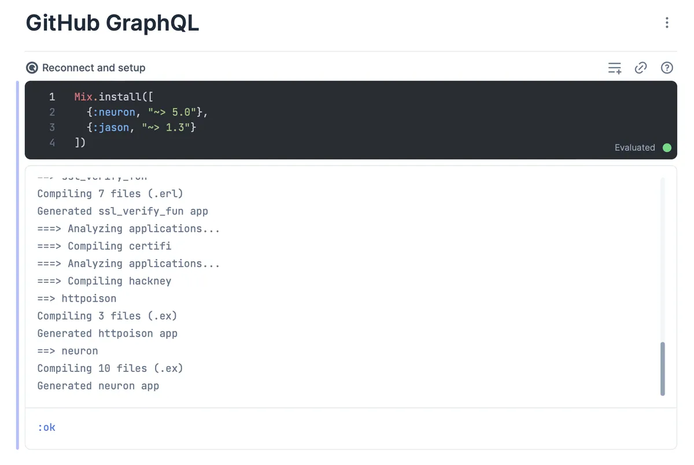
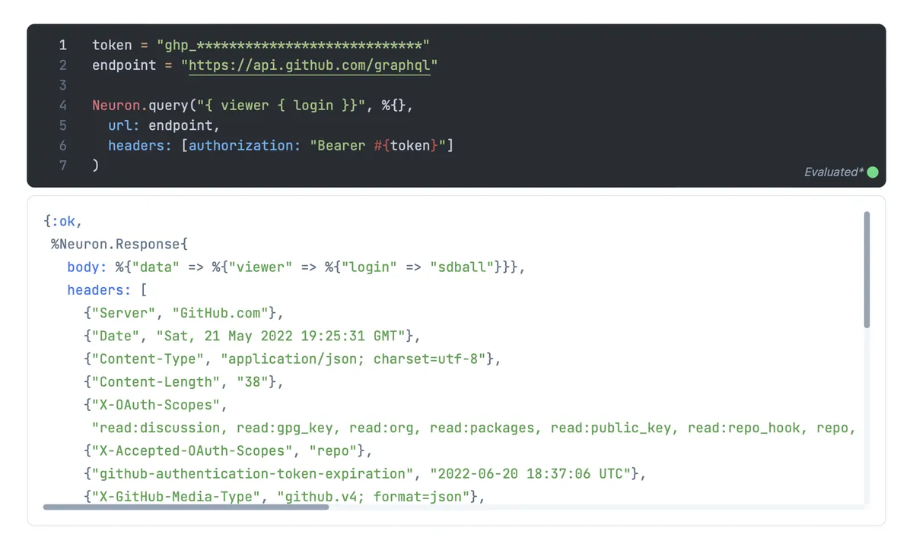
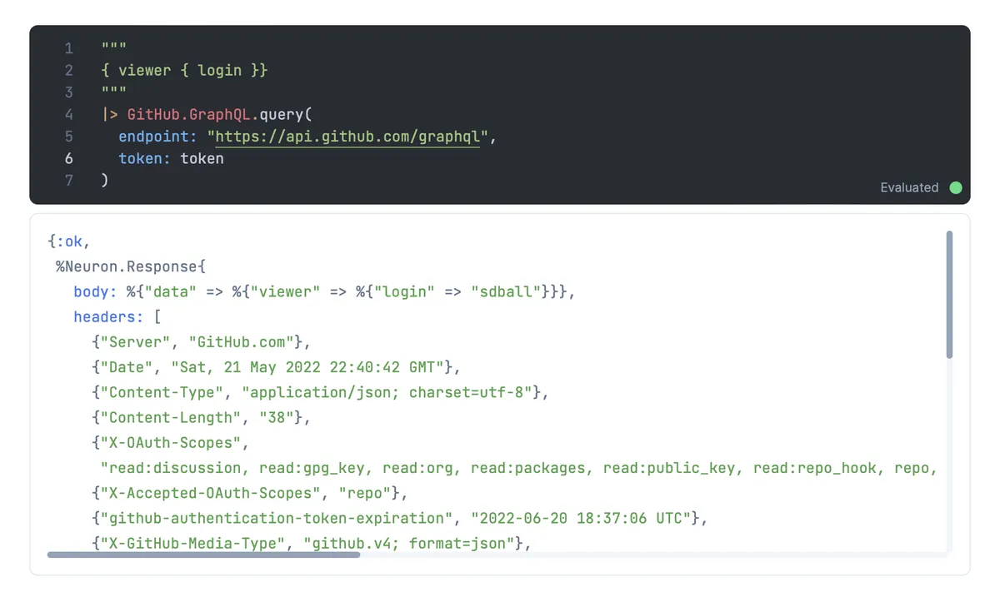
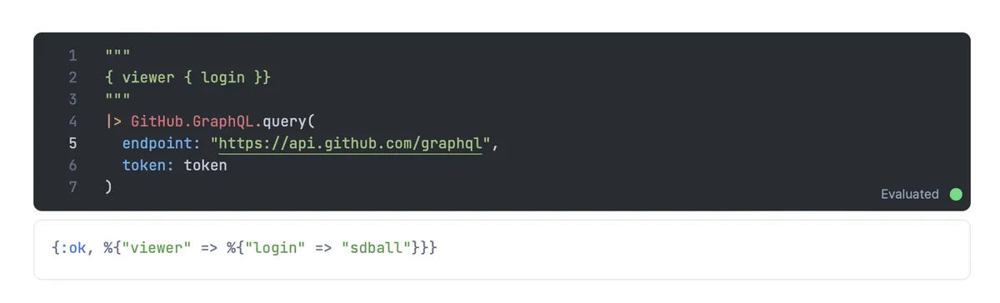
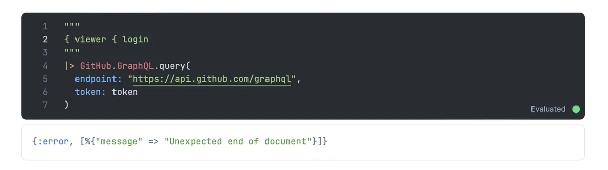
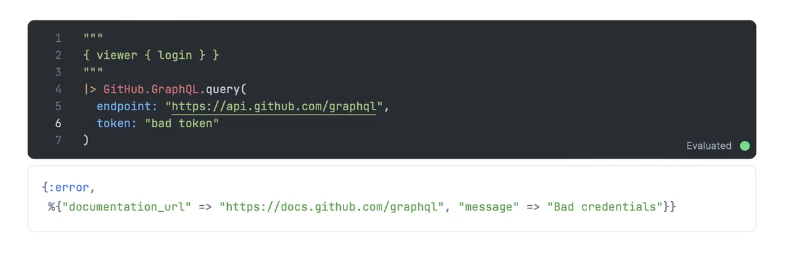
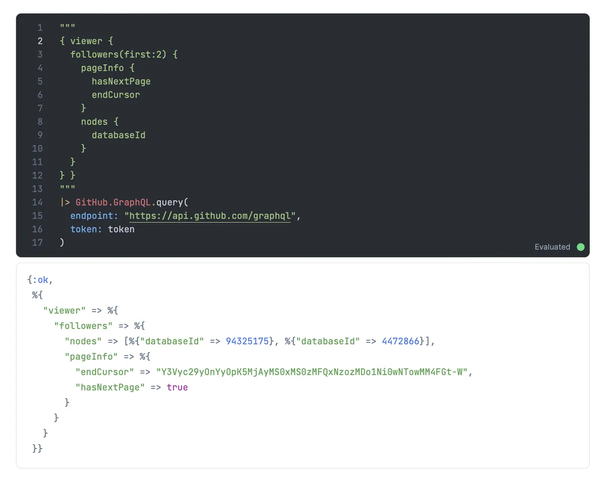
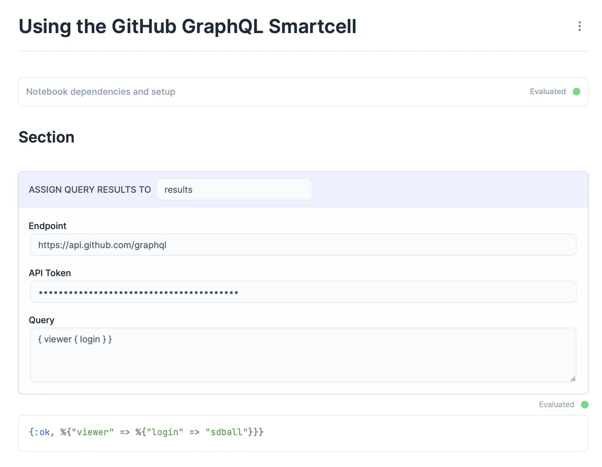
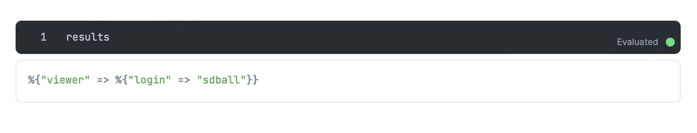

Continuing from last time [when we wrote an absolutely minimal livebook smart cell](/lets-write-an-elixir-livebook-smart-cell) we're going to write a Livebook smart cell that allows us to easily query the GitHub GraphQL API.

## Previously

Last time we wrote the simplest of simple smart cells. It only printed out a
couple of hardcoded strings and completely ignored the frontend user
experience.

This time out we'll write an interactive smart cell. Our goal will be to let a
user paste in a GitHub API token, a GraphQL query, and name a variable that
will receive the query results. The smart cell will execute the GraphQL query
and store the results in the given variable name.

## Querying the GitHub GraphQL API

If you just want to skip to querying the GitHub GraphQL API via Livebook then
you can simply start a new livebook notebook, add the
`github_graphql_smartcell` package, add a "GitHub GraphQL Query" smart cell,
and you're all set!

GitHub GraphQL Smart Cell on

- [GitHub](https://github.com/sdball/github_graphql_smartcell)
- [Hex](https://hex.pm/packages/github_graphql_smartcell)
- [Hex Docs](https://hexdocs.pm/github_graphql_smartcell/components.html)

But if you'd like to read through how to implement a more complex smart cell
then let's go!

## Let's write a smart smart cell!

Our actually smart fancy new smart cell will handle performing a GraphQL query
against the GitHub GraphQL API.

Again our first job is to figure out the pattern of code we want our smart cell
to generate.

- What (if any) dependencies does our smart cell need to function? **Kino** for
  smart cell functionality, **Neuron** for handling GraphQL queries, and
  **jason** to handle JSON.
- What end result do we want our cell to have? Print some output? Assign
  results to a variable? Interact with the Livebook users? **Users should be
  able to fill in a GitHub API token, graphql query, and variable name to
  receive the results**

As always, first we spike the code required.

## Spiking the code

We'll use the excellent [Neuron](https://github.com/uesteibar/neuron) to serve
as our GraphQL client and `jason` to handle JSON.

We'll also need a GitHub personal access token as described by their documentation [Forming calls with GraphQL](https://docs.github.com/en/graphql/guides/forming-calls-with-graphql)

Livebook is a perfect prototyping environment, let's get a Livebook going!

Either use the package adding UI to find and add neuron and jason or copy this
setup code. Then run the setup to install the dependencies.

```elixir
Mix.install([
  {:neuron, "~> 5.0"},
  {:jason, "~> 1.3"}
])
```




### Making our first GitHub GraphQL call

Believe it or not, we're ready to make a GitHub GraphQL API call!

Drop this code into a code block and run it.

```elixir
token = "ghp_YOUR_TOKEN_HERE"
endpoint = "https://api.github.com/graphql"

Neuron.query("{ viewer { login }}", %{},
  url: endpoint,
  headers: [authorization: "Bearer #{token}"]
)
```

If all goes as it should you should see results!



```elixir
{:ok,
 %Neuron.Response{
   body: %{"data" => %{"viewer" => %{"login" => "sdball"}}},
   headers: [
     {"Server", "GitHub.com"},
     {"Date", "Sat, 21 May 2022 19:25:31 GMT"},
     {"Content-Type", "application/json; charset=utf-8"},
     {"Content-Length", "38"},
     {"X-OAuth-Scopes",
      "read:discussion, read:gpg_key, read:org, read:packages, read:public_key, read:repo_hook, repo, user"},
     {"X-Accepted-OAuth-Scopes", "repo"},
     {"github-authentication-token-expiration", "2022-06-20 18:37:06 UTC"},
     {"X-GitHub-Media-Type", "github.v4; format=json"},
     {"X-RateLimit-Limit", "5000"},
     {"X-RateLimit-Remaining", "4997"},
     {"X-RateLimit-Reset", "1653161963"},
     {"X-RateLimit-Used", "3"},
     {"X-RateLimit-Resource", "graphql"},
     {"Access-Control-Expose-Headers",
      "ETag, Link, Location, Retry-After, X-GitHub-OTP, X-RateLimit-Limit, X-RateLimit-Remaining, X-RateLimit-Used, X-RateLimit-Resource, X-RateLimit-Reset, X-OAuth-Scopes, X-Accepted-OAuth-Scopes, X-Poll-Interval, X-GitHub-Media-Type, X-GitHub-SSO, X-GitHub-Request-Id, Deprecation, Sunset"},
     {"Access-Control-Allow-Origin", "*"},
     {"Strict-Transport-Security", "max-age=31536000; includeSubdomains; preload"},
     {"X-Frame-Options", "deny"},
     {"X-Content-Type-Options", "nosniff"},
     {"X-XSS-Protection", "0"},
     {"Referrer-Policy", "origin-when-cross-origin, strict-origin-when-cross-origin"},
     {"Content-Security-Policy", "default-src 'none'"},
     {"Vary", "Accept-Encoding, Accept, X-Requested-With"},
     {"X-GitHub-Request-Id", "E1DB:33B8:695955:15E21B7:62893CAB"}
   ],
   status_code: 200
 }}
```

There's a lot there in the headers, but nothing we need. At least nothing we need yet. The key data we're after is the response body.

```elixir
%{"data" => %{"viewer" => %{"login" => "sdball"}}}
```

Let's get some pattern matching and some code structure going to give us nice abstraction to get at the data.

### Abstracting our query interface

Start a new code cell. This will hold our module responsible for handling the GitHub GraphQL queries.

```elixir
defmodule GitHub.GraphQL do
end
```

Our module will have a `query/2` method that will accept an endpoint and a config map.

```elixir
defmodule GitHub.GraphQL do
  def query(query, config) do
    Neuron.query(query, %{},
      url: config[:endpoint],
      headers: [authorization: "Bearer #{config[:token]}"]
    )
  end
end
```

We can call `query/2` like so

```elixir
"""
{ viewer { login }}
"""
|> GitHub.GraphQL.query(
  endpoint: "https://api.github.com/graphql",
  token: "ghp_************************************"
)
```

And it works!



Now let's extract out the actual data as a convenience and also recognize some error patterns.

```elixir
defmodule GitHub.GraphQL do
  def query(query, config) do
    query
    |> request(config)
    |> case do
      {:ok, %Neuron.Response{status_code: 200, body: %{"errors" => errors}}} ->
        {:error, errors}
      {:ok, %Neuron.Response{status_code: 200, body: %{"data" => data}}} ->
        {:ok, data}
      {:error, %Neuron.Response{body: body}} ->
        {:error, body}
      error ->
        error
    end
  end

  def request(query, config) do
    Neuron.query(query, %{},
      url: config[:endpoint],
      headers: [authorization: "Bearer #{config[:token]}"]
    )
  end
end
```

There, now we can display the body if the response is good, or the key context
of various errors we recognize, or whatever error response doesn't match
anything else.







We can even submit more complex queries and they work just fine.



Hey check out that `pageInfo` in the query and response. That's how GraphQL
does pagination which we won't cover here. But the gist is that you have to ask
for the pagination info as part of your request and use the info in the
response to construct your next request until you either have collected all the
data you want or you've reached the end of the pages.

In the actual package I've got an initially acceptable pagination abstraction
working. But I wouldn't claim it to be complete yet.

If you want to chase those details then [Stream paginated GraphQL API in
Elixir](https://medium.com/@gottfrois/stream-paginated-graphql-api-in-elixir-11b3b5fdf8fe)
is well worth a read. If you look at my github_graphql_smartcell repo you'll
see its pagination is entirely informed by that post.

For now, let's wrap the single unpaginated query behavior we've got into a smart cell.

## Actually writing the smart cell

Like we did for the "not ready" smart cell let's do this right and package up our code.

```bash
$ mix new github_graphql_smartcell
$ cd github_graphql_smartcell
```

Add kino, jason, and neuron to our package dependencies and declare an application in mix.exs

```elixir
defmodule GithubGraphqlSmartcell.MixProject do
  use Mix.Project

  def project do
    [
      app: :github_graphql_smartcell,
      version: "0.1.0",
      elixir: "~> 1.13",
      start_permanent: Mix.env() == :prod,
      deps: deps()
    ]
  end

  def application do
    [
      mod: {GithubGraphqlSmartcell.Application, []}
    ]
  end

  defp deps do
    [
      {:kino, "~> 0.6.1"},
      {:neuron, "~> 5.0"},
      {:jason, "~> 1.3"}
    ]
  end
end
```

Write out the `lib/application.ex` file to register our smart cell.

```elixir
defmodule GithubGraphqlSmartcell.Application do
  @moduledoc false

  use Application

  @impl true
  def start(_type, _args) do
    Kino.SmartCell.register(GithubGraphqlSmartcell)
    children = []
    opts = [strategy: :one_for_one, name: KinoDB.Supervisor]
    Supervisor.start_link(children, opts)
  end
end
```

Let's put our GitHub.GraphQL module into our package.

```bash
$ mkdir lib/github
$ vim lib/github/graphql.ex
```

In that file simply paste in the module we spiked above.

```elixir
defmodule GitHub.GraphQL do
  def query(query, config) do
    query
    |> request(config)
    |> case do
      {:ok, %Neuron.Response{status_code: 200, body: %{"errors" => errors}}} ->
        {:error, errors}
      {:ok, %Neuron.Response{status_code: 200, body: %{"data" => data}}} ->
        {:ok, data}
      {:error, %Neuron.Response{body: body}} ->
        {:error, body}
      error ->
        error
    end
  end

  def request(query, config) do
    Neuron.query(query, %{},
      url: config[:endpoint],
      headers: [authorization: "Bearer #{config[:token]}"]
    )
  end
end
```

Now we have all the pieces ready: time to add the smart cell!

## At last, the smart cell

Unlike our previous smart cell this smart cell will have a UX component. A form
that allows users to enter their GitHub endpoint, API token, and GraphQL query.

That means we'll need a real main.js file and we may as well supply a real
main.css file to make things look nice. The behavior is very similar to the
database connector smart cell that ships with Livebook so that was the perfect
place for me to steal reference files and rework them to fix our needs here.

Since we need real files for our assets, we'll make it easy and declare an
`assets_path` in our smart cell.

```bash
$ mkdir -p lib/assets/github_graphql_smartcell
$ touch lib/assets/github_graphql_smartcell/main.js
$ touch lib/assets/github_graphql_smartcell/main.css
```

Now we'll go through each file in turn.

### main.css

Our main.css is the simplest file here so let's start there. Like most of my
smart cell pieces this is totally ripped off from the database connection smart
cell that ships with Livebook.

```css
.app {
  font-family: "Inter";

  box-sizing: border-box;

  --gray-50: #f8fafc;
  --gray-100: #f0f5f9;
  --gray-200: #e1e8f0;
  --gray-300: #cad5e0;
  --gray-400: #91a4b7;
  --gray-500: #61758a;
  --gray-600: #445668;
  --gray-800: #1c2a3a;

  --blue-100: #ecf0ff;
}

input,
select,
textarea,
button {
  font-family: inherit;
}

.container {
  border: solid 1px var(--gray-300);
  border-radius: 0.5rem;
  background-color: rgba(248, 250, 252, 0.3);
  padding-bottom: 8px;
}

.row {
  display: flex;
  align-items: center;
  padding: 8px 16px;
  gap: 8px;
}

.header {
  display: flex;
  justify-content: flex-start;
  background-color: var(--blue-100);
  padding: 8px 16px;
  margin-bottom: 12px;
  border-radius: 0.5rem 0.5rem 0 0;
  border-bottom: solid 1px var(--gray-200);
  gap: 16px;
}

.input {
  padding: 8px 12px;
  background-color: var(--gray-50);
  font-size: 0.875rem;
  border: 1px solid var(--gray-200);
  border-radius: 0.5rem;
  color: var(--gray-600);
}

input[type="number"] {
  appearance: textfield;
}

.input::placeholder {
  color: var(--gray-400);
}

.input:focus {
  outline: none;
  border: 1px solid var(--gray-300);
}

.input--sm {
  width: auto;
  min-width: 300px;
}

.input--xs {
  width: auto;
  min-width: 150px;
}

.input--text {
  max-width: 50%;
}

.input-label {
  display: block;
  margin-bottom: 2px;
  font-size: 0.875rem;
  color: var(--gray-800);
  font-weight: 500;
}

.inline-input-label {
  display: block;
  margin-bottom: 2px;
  color: var(--gray-600);
  font-weight: 500;
  padding-right: 6px;
  font-size: 0.875rem;
  text-transform: uppercase;
}

.field {
  display: flex;
  flex-direction: column;
}

.inline-field {
  display: flex;
  flex-direction: row;
  align-items: baseline;
}

.grow {
  flex-grow: 1;
}

.info-box {
  margin-bottom: 24px;
  padding: 16px;
  border-radius: 0.5rem;
  white-space: pre-wrap;
  font-weight: 500;
  font-size: 0.875rem;
  background-color: var(--gray-100);
  color: var(--gray-500);
}

.info-box p {
  margin: 0;
  padding: 1em 0 0.3em;
}

.info-box p:first-child {
  padding-top: 0;
}

.info-box span {
  color: var(--gray-600);
  padding-left: 0.5em;
}

.hidden {
  display: none;
}

@media only screen and (max-width: 750px) {
  .mixed-row .field {
    max-width: 32%;
  }
  .input--number {
    max-width: 100%;
  }
}

input::-webkit-outer-spin-button,
input::-webkit-inner-spin-button {
  -webkit-appearance: none;
  margin: 0;
}
```

### main.js

The main.js file is actually real this time! It holds the form for input and
handles getting the user data back to the smart cell to turn into code.

The interactions of this file could be a blog post to themselves. So we'll move on for now.

```javascript
import * as Vue from "https://cdn.jsdelivr.net/npm/vue@3.2.26/dist/vue.esm-browser.prod.js";

export function init(ctx, info) {
  ctx.importCSS("main.css");
  ctx.importCSS(
    "https://fonts.googleapis.com/css2?family=Inter:wght@400;500&display=swap"
  );

  const app = Vue.createApp({
    template: `
    <div class="app">
      <!-- Info Messages -->
      <form @change="handleFieldChange">
        <div class="container">
          <div class="row header">
            <BaseInput
              name="variable"
              label=" Assign query results to "
              type="text"
              placeholder="Assign to"
              v-model="fields.variable"
              inputClass="input input--xs input-text"
              :inline
              :required
            />
          </div>

          <div class="row">
            <BaseInput
              name="endpoint"
              label="Endpoint"
              type="text"
              placeholder="https://api.github.com/graphql"
              v-model="fields.endpoint"
              inputClass="input"
              :grow
            />
          </div>
          <div class="row">
            <BaseInput
              name="api_token"
              label="API Token"
              type="password"
              placeholder="PASTE API TOKEN"
              v-model="fields.api_token"
              inputClass="input"
              :grow
            />
          </div>
          <div class="row">
            <BaseTextArea
              name="query"
              label="Query"
              type="text"
              placeholder="{ now }"
              v-model="fields.query"
              inputClass="input"
              :grow
            />
          </div>
        </div>
      </form>
    </div>
    `,

    data() {
      return {
        fields: info.fields,
      };
    },

    methods: {
      handleFieldChange(event) {
        const { name, value } = event.target;
        ctx.pushEvent("update_field", { field: name, value });
      },
    },

    components: {
      BaseInput: {
        props: {
          label: {
            type: String,
            default: "",
          },
          inputClass: {
            type: String,
            default: "input",
          },
          modelValue: {
            type: [String, Number],
            default: "",
          },
          inline: {
            type: Boolean,
            default: false,
          },
          grow: {
            type: Boolean,
            default: false,
          },
          number: {
            type: Boolean,
            default: false,
          },
        },

        template: `
        <div v-bind:class="[inline ? 'inline-field' : 'field', grow ? 'grow' : '']">
          <label v-bind:class="inline ? 'inline-input-label' : 'input-label'">
            {{ label }}
          </label>
          <input
            :value="modelValue"
            @input="$emit('update:data', $event.target.value)"
            v-bind="$attrs"
            v-bind:class="[inputClass, number ? 'input-number' : '']"
          >
        </div>
        `,
      },
      BaseTextArea: {
        props: {
          label: {
            type: String,
            default: "",
          },
          inputClass: {
            type: String,
            default: "input",
          },
          modelValue: {
            type: [String, Number],
            default: "",
          },
          inline: {
            type: Boolean,
            default: false,
          },
          grow: {
            type: Boolean,
            default: false,
          },
          number: {
            type: Boolean,
            default: false,
          },
        },

        template: `
        <div v-bind:class="[inline ? 'inline-field' : 'field', grow ? 'grow' : '']">
          <label v-bind:class="inline ? 'inline-input-label' : 'input-label'">
            {{ label }}
          </label>
          <textarea
            rows=10
            :value="modelValue"
            @input="$emit('update:data', $event.target.value)"
            v-bind="$attrs"
            v-bind:class="[inputClass, number ? 'input-number' : '']"
          >
        </div>
        `,
      },
    },
  }).mount(ctx.root);

  ctx.handleEvent("update", ({ fields }) => {
    setValues(fields);
  });

  ctx.handleSync(() => {
    // Synchronously invokes change listeners
    document.activeElement &&
      document.activeElement.dispatchEvent(
        new Event("change", { bubbles: true })
      );
  });

  function setValues(fields) {
    for (const field in fields) {
      app.fields[field] = fields[field];
    }
  }
}
```

### lib/github_graphql_smartcell.ex

And the smartcell itself. Fundamentally it's the same as the "not ready" cell in that its ultimate job is to generate some Elixir source code via the `to_source` function. The major difference here is that the `to_source` function now actually makes use of a set of attributes that are set by the UX.

```elixir
defmodule GithubGraphqlSmartcell do
  @moduledoc false

  use Kino.JS, assets_path: "lib/assets/github_graphql_smartcell"
  use Kino.JS.Live
  use Kino.SmartCell, name: "GitHub GraphQL Query"

  @impl true
  def init(attrs, ctx) do
    fields = %{
      "variable" => Kino.SmartCell.prefixed_var_name("results", attrs["variable"]),
      "endpoint" => attrs["endpoint"] || "https://api.github.com/graphql",
      "api_token" => attrs["api_token"] || "PASTE API TOKEN",
      "query" => attrs["query"] || "{ viewer { login } }",
    }

    {:ok, assign(ctx, fields: fields)}
  end

  @impl true
  def handle_connect(ctx) do
    payload = %{
      fields: ctx.assigns.fields
    }

    {:ok, payload, ctx}
  end

  @impl true
  def to_attrs(%{assigns: %{fields: fields}}) do
    Map.take(fields, ["variable", "endpoint", "api_token", "query"])
  end

  @impl true
  def to_source(attrs) do
    quote do
      {:ok, unquote(quoted_var(attrs["variable"]))} = GitHub.GraphQL.query(unquote(attrs["query"]), endpoint: unquote(attrs["endpoint"]), token: unquote(attrs["api_token"]))
    end
    |> Kino.SmartCell.quoted_to_string()
  end

  @impl true
  def handle_event("update_field", %{"field" => field, "value" => value}, ctx) do
    updated_fields = to_updates(ctx.assigns.fields, field, value)
    ctx = update(ctx, :fields, &Map.merge(&1, updated_fields))
    broadcast_event(ctx, "update", %{"fields" => updated_fields})
    {:noreply, ctx}
  end

  defp quoted_var(string), do: {String.to_atom(string), [], nil}

  defp to_updates(fields, "variable", value) do
    if Kino.SmartCell.valid_variable_name?(value) do
      %{"variable" => value}
    else
      %{"variable" => fields["variable"]}
    end
  end

  defp to_updates(_fields, field, value), do: %{field => value}
end
```

## Run the smartcell!

With those files in place you're ready to run the smart cell locally!

Start a new livebook and in the setup cell add the package via local file path, e.g.

```elixir
Mix.install([
  {:github_graphql_smartcell, path: "/Users/sdball/learning/livebook/smartcells/github_graphql_smartcell"}
])
```

Then you can add your cell and it works!



And the query results are correctly placed into the `results` variable (or whatever variable you named)



Because it's a smart cell you can check out the generated code at any time.

```elixir
{:ok, results} =
  GitHub.GraphQL.query("{ viewer { login } }",
    endpoint: "https://api.github.com/graphql",
    token: "ghp_************************************"
  )
```

I hope this has helped demystify Livebook smart cells. To recap smart cells:

- Generate Elixir code in Livebook
- Have interconnected frontend and backend lifecycles
- Can save their data into the Livebook markdown
