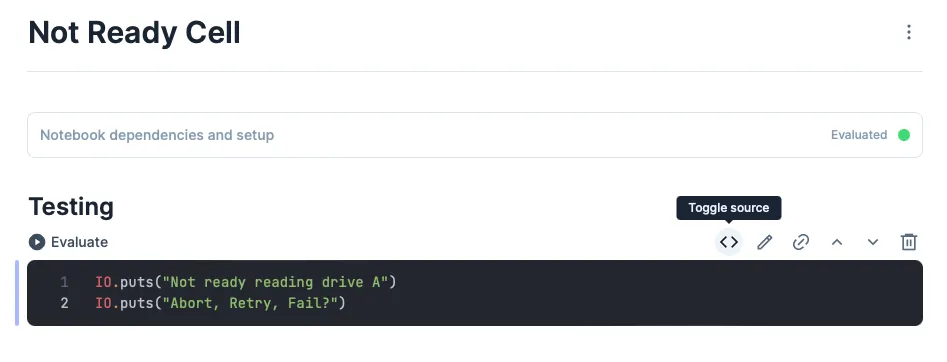
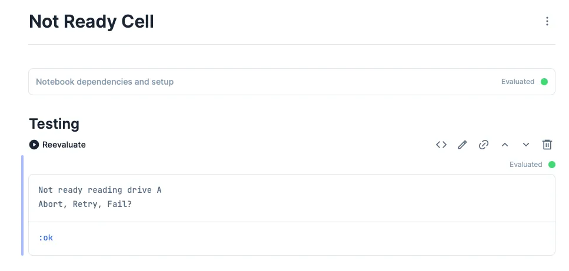

What's a Livebook? Livebook is awesome.

It's an Elixir programming notebook! You can run Livebook locally or hosted on the Internet.

The Livebook format is a superset of markdown so can be easily committed into Git repos and opened from any other Livebook instance.

Here's a snippet of my [Advent of Code 2021 - Day 7 Livebook](https://github.com/sdball/advent-of-code/blob/main/2021/day7.livemd)


What's a Livebook smart cell? It's a UX for handling the automatic generation of some code pattern. For example creating a database connection with a given host, username, and password. The shape of that code will always be the same but the specific host, username, and password can change.

Here's an example of the new database connection smart cell that ships along with Livebook 0.6


At any point you can inspect the underlying Elixir code cell. You can also tell a smart cell to drop the wrapping UX layer and simply become a hardcoded code cell like any other. That conversion is one-way: once you turn a smart cell into an Elixir code cell you can't switch it back again.

Here's that same database connection smart cell "rasterized" into hard code with the click of a button in the Livebook.

```elixir
opts = [hostname: "localhost", port: 5432, username: "", password: "", database: ""]
{:ok, conn} = Kino.start_child({Postgrex, opts})
```

That's really the magic of a smart cell: it's just code! A code template that ties into a web UX to fill in pieces of the code template with user inputs. There's a bit more too it such as handling the lifecycle of the cell and responding to updated fields but that's the gist.

## Let's write a smart cell!

Our first fancy new smart cell will very simply print an arcane bit of computer text. No interaction, no fields, no variables. It's gonna be great!

The code we want our smart cell to generate looks like this. Literally nothing variable in the output. Simply generate this Elixir code.

```elixir
IO.puts "Not ready reading drive A"
IO.puts "Abort, Retry, Fail?"
```

We could do this example completely inline in a Livebook. But let's do it extra!

```bash
$ mix new not_ready_cell
$ cd not_ready_cell
```

First off: we've got some boilerplate to lay down. Maybe eventually smart cells will have a hook into mix but for now we do this by hand.

Add `lib/application.ex` to handle some lifecycle behaviors such as actually registering our `NotReadyCell` with the set of smart cells in the Livebook.

```elixir
defmodule NotReadyCell.Application do
  @moduledoc false

  use Application

  @impl true
  def start(_type, _args) do
    Kino.SmartCell.register(NotReadyCell)
    children = []
    opts = [strategy: :one_for_one, name: KinoDB.Supervisor]
    Supervisor.start_link(children, opts)
  end
end
```

Edit `mix.exs` to add the dependency on kino itself and declare the application.

```elixir
defp deps do
  [
    {:kino, "~> 0.6.1"}
  ]
end
```

Next let's write the very simple test case for the one behavior our smart cell will exhibit: `test/not_ready_cell_test.exs`

```elixir
defmodule NotReadyCellTest do
  use ExUnit.Case, async: true

  import Kino.Test

  setup :configure_livebook_bridge

  test "supplies its hardcoded source" do
      {_kino, source} = start_smart_cell!(NotReadyCell, %{})

      assert source ==
               """
               IO.puts("Not ready reading drive A")
               IO.puts("Abort, Retry, Fail?")\
               """
  end
end
```

That test not only fails it _errors_ because we haven't given our smart cell any behavior yet. Let's do that!

Write `lib/not_ready_cell.ex` itself to hold our smart cell and its completely empty `main.js` asset.

There are some required smart cell behaviors which, in turn, require specific functions be implemented by the module. In this case I peeked at some real-life smart cells and whittled them down to the smallest amount of code that still met the requirements.

```elixir
defmodule NotReadyCell do
  @moduledoc false

  use Kino.JS
  use Kino.SmartCell, name: "Not Ready Cell"

  @impl true
  def to_source(_) do
    quote do
      IO.puts("Not ready reading drive A")
      IO.puts("Abort, Retry, Fail?")
    end |> Kino.SmartCell.quoted_to_string()
  end

  @impl true
  def to_attrs(_), do: %{}

  asset "main.js" do
    """
    """
  end
end
```

Smart cells are made up of assets and Elixir code. At a minimum they must supply or declare a `main.js` asset to handle the frontend part of the smart cell lifecycle. Even though our `NotReadyCell` has zero user interaction it must still keep up with the required contracts for being a smart cell.

The `to_attrs` function is part of the layer that translates the code to and from Liveview. That is most smart cells have some input fields that the user writes data into. Those fields need to know how to turn into attributes so they can be stored in the livebook. Our "Not Ready" cell has no fields and so has no need to do anything at all with attributes.

Because our cell is completely hardcoded with zero frontend interaction beyond writing out the code we can also get away with declaring a completely empty inline `main.js` file using the very handy asset function provided by the smart cell behaviors.

The real actual smart cell code work is done by the `to_source` function. That function is what should assemble the attributes and code template into working code. But in our cell there's no attributes only code to pass into the smart cell.

Does it test? Yes!

```bash
$ mix test
.

Finished in 0.06 seconds (0.06s async, 0.00s sync)
1 test, 0 failures

Randomized with seed 379333
```

But does it work? Let's import it into a Livebook and find out!

### Does it print? Spoiler: it does not print

Things seem to start off well. At least we can declare the dependency and complete the setup.


Right on. We even have "Not Ready Cell" registered as a smart cell.


Adding the cell to a Livebook is little underwhelming, but we can't expect too much right? We didn't give our smart cell any parts of the frontend code that it expects!


But will it print when we click evaluate?

It will not. Nothing happens when we click the "Evaluate" button.

Maybe the code isn't there. Let's peek under the hood.



Well hey we got _something_ right at least. And we can permanently convert that to a code cell and then it does evaluate and print as expected.

Looks like smart cell interactions are slightly more than simply laying down code. We probably need a some frontend/backend lifecycle hooks for our smart cell so that it knows when to evaluate. Right now I'd bet that the "Evaluate" click isn't propagating through to the smart cell.

### Let's add enough code to our smart cell so that it knows when to evaluate

Where does the lifecycle come from? Well, there's a `use Kino.JS.Live` line I've been decidedly ignoring in smart cell examples. I bet that line does something.

```elixir
use Kino.Js.Live
```

Aha that has an effect in my text editor at least. The `NotReadyCell` module now complains "Hey you haven't defined a required function for the Kino.JS.Live behavior: you need a `handle_connect/1`"

Ok lets look at what that looks like for an example smart cell.

```elixir
@impl true
def handle_connect(ctx) do
  {:ok, %{text: ctx.assigns.text}, ctx}
end
```

Ok cool, I think we can simplify that a bit since we have zero (0) assigns to worry about in our hardcoded smart cell. So let's try doing essentially nothing.

```elixir
@impl true
def handle_connect(ctx) do
  {:ok, %{}, ctx}
end
```

Hey vim is happy now. Let's give it a spin.



### Woohoo!

I declare in this brief post we have implemented perhaps the most absolutely minimal smart cell you can implement at this time. No interaction, no smartness, barely even any "cell"-ness. Simply some hardcoded code getting automatically registered as something you can insert into a Livebook if that dependency is installed.

I'm not going to publish `NotReadyCell` to hex for obvious reasons. But you can find the code for reference at [github.com/sdball/not_ready_cell](https://github.com/sdball/not_ready_cell)

Which means if you REALLY want to add it to your Livebook you can!

```elixir
Mix.install([
  {:not_ready_cell, git: "https://github.com/sdball/not_ready_cell"},
])
```

## Next time

I'm having a really great time working with Elixir Livebook smart cells. In the next post we'll write a smart cell to allow submitting GraphQL queries to the GitHub GraphQL API!
