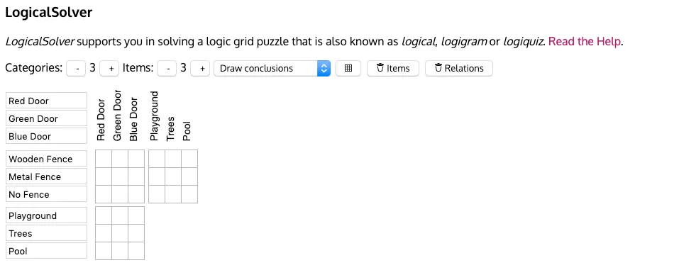
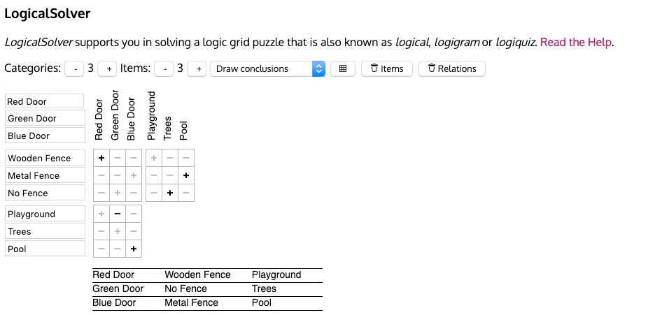
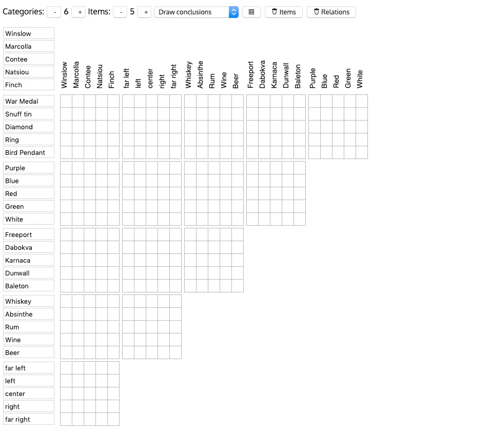

I've been playing through Dishonored 2 and last night I came across the Jindosh Lock Puzzle. It's straight forward enough. There are five family names and five heirlooms. To unlock the door you need to correct associate each family name with their heirloom and their position at a classic dinner party seating arrangement.

)

All of the information required to make the right conclusion is obfuscated in a word puzzle with six categories of five items each.

- Family name
- Heirloom
- Seating position
- Home city
- Garment color
- Drink of choice

A story in the game gives all the clues required to reach the correct conclusion but does not spell out each and every relationship directly. The fun is the keyword "obfuscated". Careful reading of the story will give you positive or negative associations between data points. The trick is that if you map out all of these associations correctly you will be able to infer all of the relationships required to solve the puzzle.

To do that purely mentally for the Jindosh riddle would be quite a feat! Luckily there's a great data structure that allows us to store each positive and negative association and spot the conclusions we can infer. The logic grid.

# A Simple Logic Grid Example

> The house with the red door has a wooden fence. The house with no fence has trees. The house with a metal fence has a pool. The house with a green door does not have a playground. The house with a blue door has a pool.

We can make some obvious associations by directly reading that text. For example the house with the metal fence must have a blue door because we know the house with a metal fence has a pool and the house with a pool has a blue door. But to make all of the associations a logic grid is supremely useful.

Luckily for us there's a fantastic website that allows us to populate the data and keep it organized: [Logical Solver](<http://www.jsingler.de/apps/logikloeser/index.php#(at:s,items:!(!('','',''),!('','',''),!('','','')),ms:t,n:!(),nc:3,ni:3,p:!(),v:0)>).

Here's a logic grid in that webapp for the above house puzzle [without any of the associations made](<http://www.jsingler.de/apps/logikloeser/index.php#(at:s,items:!(!('Red%20Door','Green%20Door','Blue%20Door'),!('Wooden%20Fence','Metal%20Fence','No%20Fence'),!(Playground,Trees,Pool)),ms:t,n:!(),nc:3,ni:3,p:!(),v:0)>):

And with the [associations from the text above filled out](<http://www.jsingler.de/apps/logikloeser/index.php#(at:s,items:!(!('Red%20Door','Green%20Door','Blue%20Door'),!('Wooden%20Fence','Metal%20Fence','No%20Fence'),!(Playground,Trees,Pool)),ms:t,n:!(a1c0),nc:3,ni:3,p:!(a0b0,b2c1,b1c2,a2c2),v:0)>):

Yeah! You can see how it's mapped out the entire mesh of associations with only those few data points.

The key to a logic grid is that each intersection of associations only appears _once_ on the grid.

To use a logic grid to solve some data associations has some requirements:

- The data must be able to be grouped into related categories
- Each category must have the same number of values
- Each category/value pair must only be allowed to occur once (e.g. in our simple example the data can't have two houses with a pool)

Not to useful for a lot of real world things, but useful enough to have in your data analysis pocket.

Here's a look at the Jindosh Logic Grid (which is well known enough to have a setting on LogicalSolver to prepopulate all the categories and values). Fun times!

And an example of how the riddle is presented. The associations are randomized for each playthrough so people can't simply put in the hardcoded answer.

> At the dinner party were Lady Winslow, Doctor Marcolla, Countess Contee, Madam Natsiou, and Baroness Finch.
>
> The women sat in a row. They all wore different colors and Doctor Marcolla wore a jaunty green hat. Baroness Finch was at the far left, next to the guest wearing a white jacket. The lady in purple sat left of someone in blue. I remember that purple outfit because the woman spilled her whiskey all over it. The traveler from Dunwall was dressed entirely in red. When one of the dinner guests bragged about her Ring, the woman next to her said they were finer in Dunwall, where she lived.
>
> So Countess Contee showed off a prized Bird Pendant at which the lady from Karnaca scoffed, saying it was no match for her War Medal.
>
> Someone else carried a valuable Diamond and when she saw it, the visitor from Fraeport next to her almost spilled her neighbor's rum.
>
> Madam Natsiou raised her absinthe in toast. The lady from dabovka, full of beer, jumped up onto the table, falling onto the guest in the center seat, spilling the poor woman's wine. Then lady Winslow captivated them all with a story about her wild youth in Baleton.
>
> In the morning, there were four heirlooms under the table: the Ring, Snuff Tin, the War Medal, and the Diamond.
>
> But who owned each?

Working out that solution by rote logic would be quite complex. But applying the right logical analysis tool makes the same work easy!
