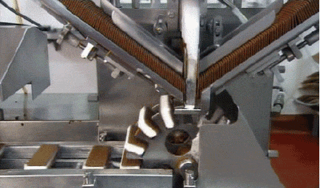

So [jq is awesome](/command-line-tools-jq/). When you need to process JSON then jq is your factory line transforming the raw JSON ingredients into delicious ice cream sandwiches.



But jq is even more awesome than that! We can actually _program_ using jq! Think of it like AWK. AWK is mostly thought of for easily parsing out fields of data but you can write programs with it as well.

Here's AWK the data parser

```bash
$ echo "key1 value1\nkey2 value2\nkey3 value3"
key1 value1
key2 value2
key3 value3

$ echo "key1 value1\nkey2 value2\nkey3 value3" | awk '{ print $2 }'
value1
value2
value3
```

And AWK with some programming in it

```bash
$ awk 'function add(a, b) { return a + b } BEGIN { print add(3,4) }'
7
```

Like AWK, jq can do more than it might seem at first use. One of the keys is that jq can take a `-n` argument which tells it not to even expect any input.

```bash
$ jq -n "[1, 2, 3]"
[
  1,
  2,
  3
]

$ jq -n "[11, 22, 33] | .[1]"
22
```

Now throw in that jq allows you to define functions, has pretty solid standard library of functions, and control flow operators and BAM we have some programming going!

Let's knock it out the park right away, 99 bottles in jq?! YES! [99 Bottles of Beer in jq](https://rosettacode.org/wiki/99_Bottles_of_Beer#jq)

```bash
def sing:
  def s: if . == 1 then "" else "s" end;
  def bottles:
    if . == 0 then "No more"
    else "\(.)"
    end + " bottle\(s)";
  (. - range(0;.+1) )
  | "
\(bottles) of beer on the wall
\(bottles) of beer
Take one down, pass it around
\(bottles) of beer on the wall."
;

$bottles | tonumber | sing
```

Seriously. The trick is that to run this script we have to tell jq a few things.

We need to pass `-n` to tell jq not to expect input. We need to pass `-r` to tell it to not pretty format the output into JSON. We need to pass it an `--arg` to give the `$bottles` variable an initial value. And we need to pass it `-f` with the script's filename.

```plaintext
$ jq -r -n --arg bottles 3 -f 99_bottles.jq

3 bottles of beer on the wall
3 bottles of beer
Take one down, pass it around
3 bottles of beer on the wall.

2 bottles of beer on the wall
2 bottles of beer
Take one down, pass it around
2 bottles of beer on the wall.

1 bottle of beer on the wall
1 bottle of beer
Take one down, pass it around
1 bottle of beer on the wall.

No more bottles of beer on the wall
No more bottles of beer
Take one down, pass it around
No more bottles of beer on the wall.
```

Pretty wild eh? I for one did not expect jq to have such power. But it does!

Let's dive through more of [Rosetta Code's jq category](https://rosettacode.org/wiki/Category:Jq). How about some [Prime decomposition](https://rosettacode.org/wiki/Prime_decomposition#jq)?

```bash
def factors:
  . as $in
  | [2, $in, false]
  | recurse( .[0] as $p |.[1] as $q | .[2] as $valid | .[3] as $s
             | if $q == 1        then empty
           elif $q % $p == 0 then [$p, $q/$p, true]
               elif $p == 2      then [3, $q, false, $s]
               else
             ($s // ($q | sqrt)) as $s
             | if $p + 2 <= $s then [$p + 2, $q, false, $s]
                   else [$q, 1, true]
           end
           end )
   | if .[2] then .[0] else empty end ;
```

```bash
$ jq -r -n 'include "factors"; 12 | factors'
2
2
3

$ jq -r -n 'include "factors"; 25 | factors'
5
5

$ jq -r -n 'include "factors"; 65535 | factors'
3
5
17
257

$ jq -r -n 'include "factors"; 7783840458009841 | factors'
19469
399806895989
```

Pretty great eh? Check out how `factors.jq` is a module that jq scripts can include (or import) directly. And jq's performance isn't bad! That huge factor at the end there takes about two seconds on my MacBook Air.

How about a fun word exercise? [Phrase reversals in jq](https://rosettacode.org/wiki/Phrase_reversals#jq)

```bash
def reverse_string: explode | reverse | implode;

"jq does more than you might think"
| split(" ") as $words
| "0. input:               \(.)",
  "1. string reversed:     \(reverse_string)",
  "2. each word reversed:  \($words | map(reverse_string) | join(" "))",
  "3. word-order reversed: \($words | reverse | join(" "))"
```

```bash
$ jq -r -n -f phrase-reversals.jq
0. input:               jq does more than you might think
1. string reversed:     kniht thgim uoy naht erom seod qj
2. each word reversed:  qj seod erom naht uoy thgim kniht
3. word-order reversed: think might you than more does jq
```

Pretty cool! jq is an amazing programming tool that does even more than parse JSON! The next time you think you need to combine jq with another programming language to build up whatever you're trying to parse from some JSON you might able to do it all in jq itself in one call.

Shout out to [Rosetta Code](http://rosettacode.org/wiki/Rosetta_Code) for being an awesome resource as always.
