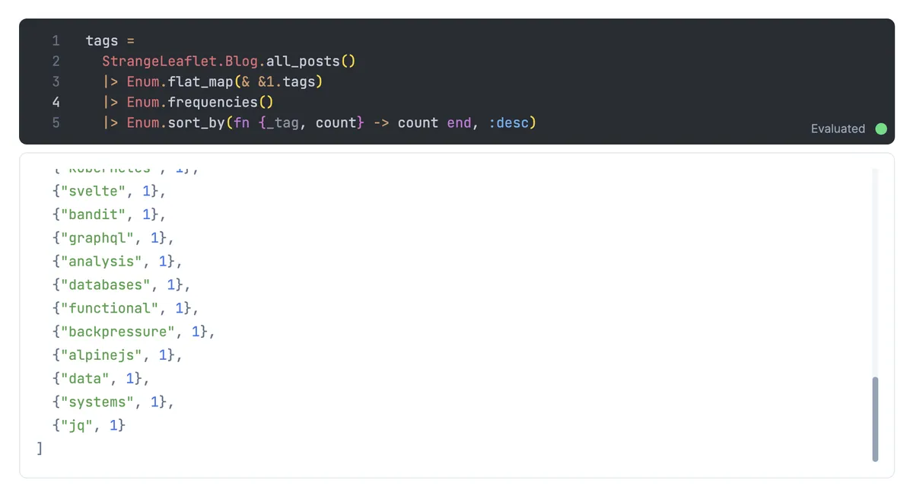

Again? Rewriting this blog again? Yes! This blog is now a Phoenix app and using LiveSvelte for frontend components. All the power of Phoenix + all the power of Svelte == awesome.

# SvelteKit

SvelteKit was great and I still say it's an interesting approach. Its foundational integration with Svelte itself is, of course, wonderful.

But check out the `src/routes` directory structure I had grown for Strange Leaflet

```
src/routes
├── +layout.svelte
├── +page.svelte
├── about
│  └── +page.svelte
├── api
│  └── blog
│     ├── +server.js
│     ├── featured
│     │  └── +server.js
│     ├── gitblogs
│     │  └── +server.js
│     ├── micro
│     │  └── +server.js
│     ├── posts
│     │  └── +server.js
│     └── search
│        └── +server.js
├── blog
│  ├── +layout.js
│  ├── +page.js
│  ├── +page.svelte
│  ├── featured
│  │  ├── +layout.js
│  │  ├── +page.server.js
│  │  └── +page.svelte
│  ├── feed[[format]]
│  │  └── +server.js
│  ├── gitblogs
│  │  ├── +layout.js
│  │  ├── +page.server.js
│  │  ├── +page.svelte
│  │  ├── [post]
│  │  │  ├── +layout.js
│  │  │  ├── +page.js
│  │  │  └── +page.svelte
│  │  └── mdsvex.svelte
│  ├── mdsvex.svelte
│  ├── micro
│  │  ├── +layout.js
│  │  ├── +page.server.js
│  │  ├── +page.svelte
│  │  └── [post]
│  │     ├── +layout.js
│  │     ├── +page.js
│  │     └── +page.svelte
│  └── posts
│     ├── +layout.js
│     ├── +page.server.js
│     ├── +page.svelte
│     ├── [post]
│     │  ├── +layout.js
│     │  ├── +page.js
│     │  └── +page.svelte
│     └── mdsvex.svelte
├── contact
│  └── +page.svelte
├── feed[[format]]
│  └── +server.js
└── search
   ├── +page.server.js
   └── +page.svelte
```

Not _terrible_ but I found myself editing the wrong `+page.svelte` file or `+server.js` file more than once. And any additional routes would compound the problem.

Here's the complexity around getting blog posts

```javascript
const blogItems = (globbed) => {
  return Object.entries(globbed)
    .map(([path, meta]) => {
      meta.metadata.date = new Date(meta.metadata.date);

      return {
        path: path
          .replace(/^\/src\/lib/, "")
          .replace(/\.svx$/, "")
          .replace(/\/index$/, ""),
        ...meta,
      };
    })
    .sort((a, b) => {
      return b.metadata.date - a.metadata.date;
    });
};

export const fetchPosts = async () => {
  const postFiles = import.meta.glob("/src/lib/blog/posts/**/*.svx", {
    eager: true,
  });
  return blogItems(postFiles);
};
```

# Phoenix

Conversely this is the `lib` directory tree for this Phoenix app

```
lib
├── mix
│  └── tasks
│     └── strangeleaflet.blog.gen.feed.ex
├── strange_leaflet
│  ├── application.ex
│  ├── blog
│  │  ├── blog.ex
│  │  └── post.ex
│  └── mailer.ex
├── strange_leaflet.ex
├── strange_leaflet_web
│  ├── components
│  │  ├── core_components.ex
│  │  ├── layouts
│  │  │  ├── app.html.heex
│  │  │  └── root.html.heex
│  │  └── layouts.ex
│  ├── controllers
│  │  ├── blog_controller.ex
│  │  ├── blog_html
│  │  │  ├── index.html.heex
│  │  │  ├── pagination.html.heex
│  │  │  ├── show.html.heex
│  │  │  ├── tagged.html.heex
│  │  │  └── tags.html.heex
│  │  ├── blog_html.ex
│  │  ├── error_html
│  │  │  ├── 404.html.heex
│  │  │  └── 500.html.heex
│  │  ├── error_html.ex
│  │  ├── error_json.ex
│  │  ├── page_controller.ex
│  │  ├── page_html
│  │  │  ├── about.html.heex
│  │  │  └── homepage.html.heex
│  │  ├── page_html.ex
│  │  ├── widget_controller.ex
│  │  └── widget_html.ex
│  ├── endpoint.ex
│  ├── gettext.ex
│  ├── router.ex
│  └── telemetry.ex
└── strange_leaflet_web.ex
```

Much easier to follow and organize concepts, at least for me. Certainly easier to wire up new routes!

```elixir
get "/widgets", WidgetController, :index
get "/widgets/:id", WidgetController, :show
```

And because it's Elixir I can run my application and connect Livebook to that running application and interact with my code using Livebook as a wonderful REPL. Here's me figuring out the code to build up the list of tags and counts from posts.



# LiveSvelte

Thanks to [LiveSvelte](https://github.com/woutdp/live_svelte) I don't have to give up the power of Svelte components for the frontend! Everything in [/widgets](https://strangeleaflet.fly.dev/widgets) is currently a Svelte component. I could add LiveView components as well. I could even have Svelte components wired up to LiveView!

The navigation header you see is still a Flowbite-Svelte component. I still have my customized [penguin component](/rebooting-this-blog-in-svelte-and-sveltekit/#why-svelte).

# Svelte

How's the Svelte component experience? Pretty great!

I have `assets/svelte` and all the Svelte components are in that directory. If I want to use any npm packages such as the excellent [Flowbite Svelte](https://flowbite-svelte.com/) I simply add them in the `assets` directory which has a normal `package.json` and them they're available to use in a Svelte component.

```javascript
import { Pagination } from "flowbite-svelte";
```

# NimblePublisher

Instead of mdsvex to organize `.svx` (Svelte + Markdown) files as blog posts I'm using [NimblePublisher](https://github.com/dashbitco/nimble_publisher) from Dashbit. It serves a similar purpose but I get to use Elixir and a well thought out developer experience to organize blog posts.

Elixir school has an [excellent tutorial on using NimblePublisher](https://elixirschool.com/en/lessons/misc/nimble_publisher) if you're interested.

Here's how I tell NimblePublisher where and what to find as blog posts.

```elixir
use NimblePublisher,
  build: Post,
  from: Application.app_dir(:strange_leaflet, "priv/posts/**/*.md"),
  as: :posts,
  highlighters: [:makeup_elixir, :makeup_erlang, :makeup_json, :makeup_js]
```

And to have a sorted set of `@posts`?

```elixir
@posts Enum.sort_by(@posts, & &1.date, {:desc, Date})
```

Here's how I build up my [tag list](/blog/).

```elixir
@tags @posts
      |> Enum.flat_map(& &1.tags)
      |> Enum.frequencies()
      |> Enum.sort_by(fn {_tag, count} -> count end, :desc)
```

This experience being so smooth and easy is key for me since I want to introduce a "leaflet" concept separate from blog posts.

I have a great blog writing experience, a powerful web backend, and a powerful web frontend: all in one app!
