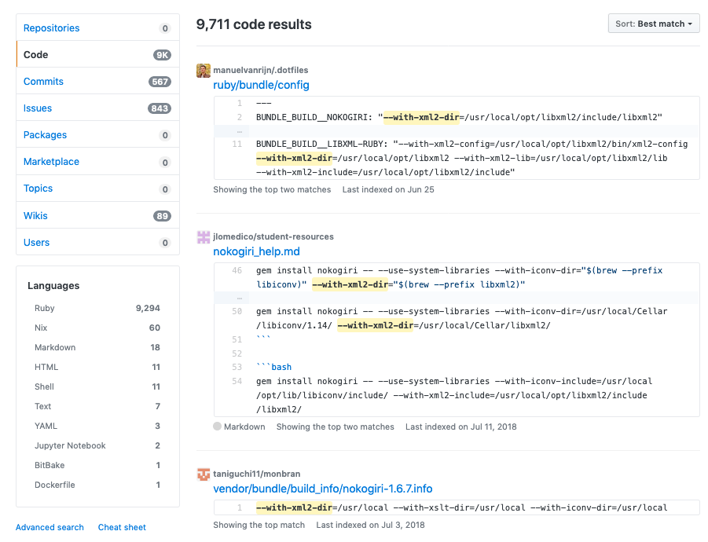

"Ok! Let's check out this Rails 6 goodness", I thought.

- Clone rails/rails — easy
- Look around the latest commits — a great way to see what's been going on
- `bundle install` :-(

# Error 1: Failed to install libxml-ruby 3.10 gem

```plaintext
Installing libxml-ruby 3.1.0 with native extensions
Gem::Ext::BuildError: ERROR: Failed to build gem native extension.

    current directory: /Users/sdball/.rbenv/versions/2.6.5/lib/ruby/gems/2.6.0/gems/libxml-ruby-3.1.0/ext/libxml
/Users/sdball/.rbenv/versions/2.6.5/bin/ruby -I /Users/sdball/.rbenv/versions/2.6.5/lib/ruby/2.6.0 -r
./siteconf20191130-15096-mz0ci9.rb extconf.rb
/Users/sdball/.rbenv/versions/2.6.5/bin/ruby: warning: shebang line ending with \r may cause problems
checking for libxml/xmlversion.h in
/opt/include/libxml2,/opt/local/include/libxml2,/usr/local/include/libxml2,/usr/include/libxml2... no
*** extconf.rb failed ***
Could not create Makefile due to some reason, probably lack of necessary
libraries and/or headers.  Check the mkmf.log file for more details.  You may
need configuration options.

Provided configuration options:
    --with-opt-dir
    --without-opt-dir
    --with-opt-include
    --without-opt-include=${opt-dir}/include
    --with-opt-lib
    --without-opt-lib=${opt-dir}/lib
    --with-make-prog
    --without-make-prog
    --srcdir=.
    --curdir
    --ruby=/Users/sdball/.rbenv/versions/2.6.5/bin/$(RUBY_BASE_NAME)
    --with-xml2-config
    --without-xml2-config
    --with-xml2-dir
    --without-xml2-dir
    --with-xml2-include
    --without-xml2-include=${xml2-dir}/include
    --with-xml2-lib
    --without-xml2-lib=${xml2-dir}/lib
 extconf failure: need libxml2.

    Install the library or try one of the following options to extconf.rb:

      --with-xml2-config=/path/to/xml2-config
      --with-xml2-dir=/path/to/libxml2
      --with-xml2-lib=/path/to/libxml2/lib
      --with-xml2-include=/path/to/libxml2/include


To see why this extension failed to compile, please check the mkmf.log which can be found here:

  /Users/sdball/.rbenv/versions/2.6.5/lib/ruby/gems/2.6.0/extensions/x86_64-darwin-18/2.6.0/libxml-ruby-3.1.0/mkmf.log

extconf failed, exit code 1

Gem files will remain installed in /Users/sdball/.rbenv/versions/2.6.5/lib/ruby/gems/2.6.0/gems/libxml-ruby-3.1.0 for inspection.
Results logged to
/Users/sdball/.rbenv/versions/2.6.5/lib/ruby/gems/2.6.0/extensions/x86_64-darwin-18/2.6.0/libxml-ruby-3.1.0/gem_make.out

An error occurred while installing libxml-ruby (3.1.0), and Bundler cannot continue.
Make sure that `gem install libxml-ruby -v '3.1.0' --source 'https://rubygems.org/'` succeeds before bundling.

In Gemfile:
  libxml-ruby
```

Ok this isn't too weird. There must be some libxml library that I need to install first so the rubygem has the files it needs. And check it out: `extconf failure: need libxml2`

So let's fix that!

```bash
$ brew install libxml2
==> Downloading https://homebrew.bintray.com/bottles/libxml2-2.9.10.mojave.bottle.tar.gz
==> Downloading from https://akamai.bintray.com/47/472ed1a73a91c49fd9f39bd8cc4a7472b09c691659b3b9305c9da42ed35e1475?__gda__=exp=15
######################################################################## 100.0%
==> Pouring libxml2-2.9.10.mojave.bottle.tar.gz
==> Caveats
libxml2 is keg-only, which means it was not symlinked into /usr/local,
because macOS already provides this software and installing another version in
parallel can cause all kinds of trouble.

If you need to have libxml2 first in your PATH run:
  echo 'export PATH="/usr/local/opt/libxml2/bin:$PATH"' >> ~/.zshrc

For compilers to find libxml2 you may need to set:
  export LDFLAGS="-L/usr/local/opt/libxml2/lib"
  export CPPFLAGS="-I/usr/local/opt/libxml2/include"

For pkg-config to find libxml2 you may need to set:
  export PKG_CONFIG_PATH="/usr/local/opt/libxml2/lib/pkgconfig"

==> Summary
🍺  /usr/local/Cellar/libxml2/2.9.10: 280 files, 10.5MB
```

Great!

```bash
Fetching libxml-ruby 3.1.0
Installing libxml-ruby 3.1.0 with native extensions
Gem::Ext::BuildError: ERROR: Failed to build gem native extension.

    current directory: /Users/sdball/.rbenv/versions/2.6.5/lib/ruby/gems/2.6.0/gems/libxml-ruby-3.1.0/ext/libxml
/Users/sdball/.rbenv/versions/2.6.5/bin/ruby -I /Users/sdball/.rbenv/versions/2.6.5/lib/ruby/2.6.0 -r
./siteconf20191130-53906-d0hyry.rb extconf.rb
/Users/sdball/.rbenv/versions/2.6.5/bin/ruby: warning: shebang line ending with \r may cause problems
checking for libxml/xmlversion.h in
/opt/include/libxml2,/opt/local/include/libxml2,/usr/local/include/libxml2,/usr/include/libxml2... no
*** extconf.rb failed ***
Could not create Makefile due to some reason, probably lack of necessary
libraries and/or headers.  Check the mkmf.log file for more details.  You may
need configuration options.

Provided configuration options:
    --with-opt-dir
    --without-opt-dir
    --with-opt-include
    --without-opt-include=${opt-dir}/include
    --with-opt-lib
    --without-opt-lib=${opt-dir}/lib
    --with-make-prog
    --without-make-prog
    --srcdir=.
    --curdir
    --ruby=/Users/sdball/.rbenv/versions/2.6.5/bin/$(RUBY_BASE_NAME)
    --with-xml2-config
    --without-xml2-config
    --with-xml2-dir
    --without-xml2-dir
    --with-xml2-include
    --without-xml2-include=${xml2-dir}/include
    --with-xml2-lib
    --without-xml2-lib=${xml2-dir}/lib
 extconf failure: need libxml2.

    Install the library or try one of the following options to extconf.rb:

      --with-xml2-config=/path/to/xml2-config
      --with-xml2-dir=/path/to/libxml2
      --with-xml2-lib=/path/to/libxml2/lib
      --with-xml2-include=/path/to/libxml2/include


To see why this extension failed to compile, please check the mkmf.log which can be found here:

  /Users/sdball/.rbenv/versions/2.6.5/lib/ruby/gems/2.6.0/extensions/x86_64-darwin-18/2.6.0/libxml-ruby-3.1.0/mkmf.log

extconf failed, exit code 1

Gem files will remain installed in /Users/sdball/.rbenv/versions/2.6.5/lib/ruby/gems/2.6.0/gems/libxml-ruby-3.1.0 for inspection.
Results logged to
/Users/sdball/.rbenv/versions/2.6.5/lib/ruby/gems/2.6.0/extensions/x86_64-darwin-18/2.6.0/libxml-ruby-3.1.0/gem_make.out

An error occurred while installing libxml-ruby (3.1.0), and Bundler cannot continue.
Make sure that `gem install libxml-ruby -v '3.1.0' --source 'https://rubygems.org/'` succeeds before bundling.

In Gemfile:
  libxml-ruby
```

Aww c'mon. I guess simply installing the library isn't enough. I should actually read those homebrew install details.

```bash
If you need to have libxml2 first in your PATH run:
  echo 'export PATH="/usr/local/opt/libxml2/bin:$PATH"' >> ~/.zshrc

For compilers to find libxml2 you may need to set:
  export LDFLAGS="-L/usr/local/opt/libxml2/lib"
  export CPPFLAGS="-I/usr/local/opt/libxml2/include"

For pkg-config to find libxml2 you may need to set:
  export PKG_CONFIG_PATH="/usr/local/opt/libxml2/lib/pkgconfig"
```

Ok, cool. Coooool. I guess I should set one of those flags.

```bash
$ gem install libxml-ruby -v '3.1.0' --source 'https://rubygems.org/' --with-xml-dir=/usr/local/opt/libxml2
ERROR:  While executing gem ... (OptionParser::InvalidOption)
    invalid option: --with-xml-dir=/usr/local/opt/libxml2
```

Uh hm. I say I should set one of those flags.

```bash
gem install libxml-ruby -v '3.1.0' --source 'https://rubygems.org/' --with-xml-dir "/usr/local/opt/libxml2"
ERROR:  While executing gem ... (OptionParser::InvalidOption)
    invalid option: --with-xml-dir
```

Uh.

```bash
$ gem install libxml-ruby -v '3.1.0' --source 'https://rubygems.org/' --with-xml-dir /usr/local/opt/libxml2
ERROR:  While executing gem ... (OptionParser::InvalidOption)
    invalid option: --with-xml-dir
```

Ok. A quick DuckDuckGo and yeah, we need to separate our options with `--` to indicate that we're passing separate options.

```bash
$ gem install libxml-ruby -v '3.1.0' --source 'https://rubygems.org/' -- --with-xml-dir=/usr/local/opt/libxml2
Building native extensions with: '--with-xml-dir=/usr/local/opt/libxml2'
This could take a while...
ERROR:  Error installing libxml-ruby:
    ERROR: Failed to build gem native extension.

    current directory: /Users/sdball/.rbenv/versions/2.6.5/lib/ruby/gems/2.6.0/gems/libxml-ruby-3.1.0/ext/libxml
/Users/sdball/.rbenv/versions/2.6.5/bin/ruby -I /Users/sdball/.rbenv/versions/2.6.5/lib/ruby/2.6.0 -r ./siteconf20191130-58777-73jhsk.rb extconf.rb --with-xml-dir\=/usr/local/opt/libxml2
/Users/sdball/.rbenv/versions/2.6.5/bin/ruby: warning: shebang line ending with \r may cause problems
checking for libxml/xmlversion.h in /opt/include/libxml2,/opt/local/include/libxml2,/usr/local/include/libxml2,/usr/include/libxml2... no
*** extconf.rb failed ***
Could not create Makefile due to some reason, probably lack of necessary
libraries and/or headers.  Check the mkmf.log file for more details.  You may
need configuration options.
```

Well that's not what I was hoping for.

I tried various combinations of paths and options but to no avail.

Web searches aren't working to provide the details for this weird install option declaration. Time for my secret weapon: GitHub code searches!

[Searching GitHub code for `--with-xml2-dir`](https://github.com/search?q=--with-xml2-dir&type=Code)



There we go! Someone's already figured some magical declarations for me! Specifically [manuelvanrijn](https://github.com/manuelvanrijn) with his nicely organized [dotfiles repo](https://github.com/manuelvanrijn/.dotfiles) containing a [bundler config with the declarations I want](https://github.com/manuelvanrijn/.dotfiles/blob/61beb3184b30a4476d1c7cc65b60a6ef05a74094/ruby/bundle/config).

```yaml
---
BUNDLE_BUILD__NOKOGIRI: "--with-xml2-dir=/usr/local/opt/libxml2/include/libxml2"
BUNDLE_GEM__COC: "true"
BUNDLE_GEM__MIT: "true"
BUNDLE_GEM__TEST: "rspec"
BUNDLE_BUILD__EVENTMACHINE: "--with-cppflags=-I/usr/local/opt/openssl/include"
BUNDLE_JOBS: "11"
BUNDLE_IGNORE_MESSAGES__CAPISTRANO-HARROW: "true"
BUNDLE_IGNORE_MESSAGES__CAPISTRANO: "true"
BUNDLE_BUILD__MYSQL: "--with-mysql-config=/usr/local/Cellar/mysql@5.7/5.7.25/bin/mysql_config --with-ldflags=-L/usr/local/opt/openssl/lib --with-cppflags=-I/usr/local/opt/openssl/include"
BUNDLE_BUILD__LIBXML-RUBY: "--with-xml2-config=/usr/local/opt/libxml2/bin/xml2-config --with-xml2-dir=/usr/local/opt/libxml2 --with-xml2-lib=/usr/local/opt/libxml2/lib --with-xml2-include=/usr/local/opt/libxml2/include"
```

Trying out that first approach with a `.bundle/config` and woo!

```bash
$ cat .bundle/config
BUNDLE_BUILD__LIBXML-RUBY: "--with-xml2-config=/usr/local/opt/libxml2/bin/xml2-config --with-xml2-dir=/usr/local/opt/libxml2 --with-xml2-lib=/usr/local/opt/libxml2/lib --with-xml2-include=/usr/local/opt/libxml2/include"

$ gem install libxml-ruby -v '3.1.0' --source 'https://rubygems.org/' -- --with-xml2-config=/usr/local/opt/libxml2/bin/xml2-config --with-xml2-dir=/usr/local/opt/libxml2 --with-xml2-lib=/usr/local/opt/libxml2/lib --with-xml2-include=/usr/local/opt/libxml2/include
Building native extensions with: '--with-xml2-config=/usr/local/opt/libxml2/bin/xml2-config --with-xml2-dir=/usr/local/opt/libxml2 --with-xml2-lib=/usr/local/opt/libxml2/lib --with-xml2-include=/usr/local/opt/libxml2/include'
This could take a while...
Successfully installed libxml-ruby-3.1.0
```

# Error 2: Failed to install mysql gem

```plaintext
An error occurred while installing mysql2 (0.5.2), and Bundler cannot continue.
Make sure that `gem install mysql2 -v '0.5.2' --source 'https://rubygems.org/'` succeeds before bundling.

In Gemfile:
  mysql2
```

So again we probably need some more header files to build a gem.

```bash
$ brew install mysql

$ gem install mysql2
Building native extensions. This could take a while...
ERROR:  Error installing mysql2:
    ERROR: Failed to build gem native extension.

    current directory: /Users/sdball/.rbenv/versions/2.6.5/lib/ruby/gems/2.6.0/gems/mysql2-0.5.3/ext/mysql2
/Users/sdball/.rbenv/versions/2.6.5/bin/ruby -I /Users/sdball/.rbenv/versions/2.6.5/lib/ruby/2.6.0 -r ./siteconf20191130-87797-zmrpf5.rb extconf.rb
checking for rb_absint_size()... yes
checking for rb_absint_singlebit_p()... yes
checking for rb_wait_for_single_fd()... yes
-----
Using mysql_config at /usr/local/bin/mysql_config
-----
checking for mysql.h... yes
checking for errmsg.h... yes
checking for SSL_MODE_DISABLED in mysql.h... yes
checking for SSL_MODE_PREFERRED in mysql.h... yes
checking for SSL_MODE_REQUIRED in mysql.h... yes
checking for SSL_MODE_VERIFY_CA in mysql.h... yes
checking for SSL_MODE_VERIFY_IDENTITY in mysql.h... yes
checking for MYSQL.net.vio in mysql.h... yes
checking for MYSQL.net.pvio in mysql.h... no
checking for MYSQL_ENABLE_CLEARTEXT_PLUGIN in mysql.h... yes
checking for SERVER_QUERY_NO_GOOD_INDEX_USED in mysql.h... yes
checking for SERVER_QUERY_NO_INDEX_USED in mysql.h... yes
checking for SERVER_QUERY_WAS_SLOW in mysql.h... yes
checking for MYSQL_OPTION_MULTI_STATEMENTS_ON in mysql.h... yes
checking for MYSQL_OPTION_MULTI_STATEMENTS_OFF in mysql.h... yes
checking for my_bool in mysql.h... no
-----
Don't know how to set rpath on your system, if MySQL libraries are not in path mysql2 may not load
-----
-----
Setting libpath to /usr/local/Cellar/mysql/8.0.18_1/lib
-----
creating Makefile

current directory: /Users/sdball/.rbenv/versions/2.6.5/lib/ruby/gems/2.6.0/gems/mysql2-0.5.3/ext/mysql2
make "DESTDIR=" clean

current directory: /Users/sdball/.rbenv/versions/2.6.5/lib/ruby/gems/2.6.0/gems/mysql2-0.5.3/ext/mysql2
make "DESTDIR="
compiling client.c
compiling infile.c
compiling mysql2_ext.c
compiling result.c
compiling statement.c
linking shared-object mysql2/mysql2.bundle
ld: library not found for -lssl
clang: error: linker command failed with exit code 1 (use -v to see invocation)
make: *** [mysql2.bundle] Error 1

make failed, exit code 2

Gem files will remain installed in /Users/sdball/.rbenv/versions/2.6.5/lib/ruby/gems/2.6.0/gems/mysql2-0.5.3 for inspection.
Results logged to /Users/sdball/.rbenv/versions/2.6.5/lib/ruby/gems/2.6.0/extensions/x86_64-darwin-18/2.6.0/mysql2-0.5.3/gem_make.out
```

Yeah that's not SUPER great!

Luckily Manuel is the best and also has a mysql declaration I can try.

```yaml
BUNDLE_BUILD__MYSQL: "--with-mysql-config=/usr/local/Cellar/mysql@5.7/5.7.25/bin/mysql_config --with-ldflags=-L/usr/local/opt/openssl/lib --with-cppflags=-I/usr/local/opt/openssl/include"
```

But no, we still run into the key error:

```plaintext
ld: library not found for -lssl
```

This time a web search found a potential answer: [ld: library not found for -lssl while installing mysql2 gem](https://stackoverflow.com/questions/57047085/ld-library-not-found-for-lssl-while-installing-mysql2-gem)

Let's try out the suggested fix. MORE declarations to ensure that the mysql2 gem picks up /usr/local/lib/openssl.

```bash
$ gem install mysql2 -v '0.5.2' -- --with-cflags=\"-I/usr/local/opt/openssl/include\" --with-ldflags=\"-L/usr/local/opt/openssl/lib\"
Building native extensions with: '--with-cflags="-I/usr/local/opt/openssl/include" --with-ldflags="-L/usr/local/opt/openssl/lib"'
This could take a while...
Successfully installed mysql2-0.5.2
Parsing documentation for mysql2-0.5.2
Installing ri documentation for mysql2-0.5.2
Done installing documentation for mysql2 after 0 seconds
1 gem installed
```

So neat, let's fix that bundler config. (And belatedly realize the original config was for mysql and not mysql2.)

```yaml
BUNDLE_BUILD__MYSQL2: '--with-cflags="-I/usr/local/opt/openssl/include" --with-ldflags="-L/usr/local/opt/openssl/lib"'
```

But nooo! For whatever reason I simply could not get the bundler config to affect my `gem install mysql2` outcome.

So ok fine. We can gem install and then bundler will see that the gem is already available.

```bash
$ gem install mysql2 -v '0.5.2' -- --with-cflags=\"-I/usr/local/opt/openssl/include\" --with-ldflags=\"-L/usr/local/opt/openssl/lib\"
```

Then one very long `bundle install` later and:

```plaintext
Bundle complete! 67 Gemfile dependencies, 192 gems now installed.
```

Hooray!
