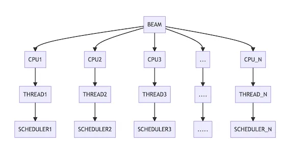

« [back to page 1](/strange-leaflet-about-elixir-page-1/) || [turn to page 3](/strange-leaflet-about-elixir-page-3/) »

If you like there's a [Livebook version of this post](https://livebook.dev/run?url=https%3A%2F%2Fgithub.com%2Fsdball%2Flivebooks%2Fblob%2Fmain%2Fbooks%2Fstrange-leaflet-about-elixir%2Fpage2.livemd) where you can actually run code and follow along. This was written to be a Livebook first, but works well enough as a post too.

## The BEAM?

Well the BEAM is what gives Erlang its power.

The BEAM is the Erlang VM and it is a huge part of what make Erlang (and hence Elixir) special.


### SIDE NOTE

Erlang and Elixir are not competitors, they aren't locked in a bitter struggle to establish dominance. Both languages run on the Erlang VM (BEAM) and can call each other completely transparently.

Let me show you some Erlang being called from some Elixir.

```elixir
:timer.sleep(100)
```

That sleep is the same as this Elixir code.

```elixir
Process.sleep(100)
```

`:timer` is an Erlang module. That's right to call Erlang from Elixir you just call the functions there's no magic involved except the magic of the BEAM.

## So the BEAM

Yes the BEAM!

Let's start up an Elixir runtime and see what goes on here.

First: `beam`

The `beam` command starts in a single operating system process.

It's important to understand that your operating system has processes but those are entirely different than Elixir processes.

```elixir
{stdout, exitcode} = System.cmd("pgrep", ["-f", "beam.smp"])

beam_operating_system_process_ids = String.split(stdout, "\n", trim: true)

beam_operating_system_process_ids
|> Enum.map(fn os_pid ->
  {stdout, 0} = System.cmd("ps", [os_pid, "-o", "pid=,command="])
  stdout
end)
|> Enum.join("\n")
|> Kino.Markdown.new()
```

If you were running this in Livebook you'd be able to see a cool live output of those system commands right in the Livebook but you aren't so here.

```shell
$ pgrep -f beam.smp | xargs -L 1 ps -o pid=,command= | awk '{print $0 "\n"}'
```

That shell command will print out any commands with `beam.smp` in the command which is the Erlang BEAM VM command. The `awk` bit will put newlines between the lines which can be quite verbose e.g.

```
14966 /opt/homebrew/Cellar/erlang/24.3.2/lib/erlang/erts-12.3/bin/beam.smp --
-root /opt/homebrew/Cellar/erlang/24.3.2/lib/erlang -progname erl -- -home
/Users/sdball -- -pa /opt/homebrew/Cellar/elixir/1.13.3/bin/../lib/eex/ebin
/opt/homebrew/Cellar/elixir/1.13.3/bin/../lib/elixir/ebin
/opt/homebrew/Cellar/elixir/1.13.3/bin/../lib/ex_unit/ebin
/opt/homebrew/Cellar/elixir/1.13.3/bin/../lib/iex/ebin
/opt/homebrew/Cellar/elixir/1.13.3/bin/../lib/logger/ebin
/opt/homebrew/Cellar/elixir/1.13.3/bin/../lib/mix/ebin -elixir ansi_enabled
true -noshell -s elixir start_cli -extra /opt/homebrew/bin/mix phx.server
```

What we can see from that output is the `beam` commands running on your system. Or at least running on the system running this Livebook. (But you aren't running this Livebook so, uh, that's what it would be showing.)

BEAM stands for Bogdan/Björn's Erlang Abstract Machine, which is the virtual machine at the core of the Erlang Open Telecom Platform (OTP).

When the `beam` command runs it starts the Erlang VM. Not a VM like a VMWare Fusion or VirtualBox VM: but a VM in a sense that it is a _virtual machine_ that Elixir code talks to which abstracts away the actual machine that the beam is running on.

When it starts up, BEAM creates a **thread** for each CPU.

Each threads runs a **scheduler** that is responsible for, well, scheduling processes (now we're talking about Elixir processes) to run.

Let's stop for a second and think about that. This is the magic that allows Elixir systems to be highly scalable. Typical (well designed!) Elixir systems have thousands to millions of processes. Due to the nature of HOW BEAM WORKS FUNDAMENTALLY those processes are scheduled across ALL the CPUs available on your system.

That means as an Elixir programmer you essentially get scalable performance for free. You don't have to think about how to design your threads and locks and waits: you write your processes that send messages to each other and BEAM spreads them around all the CPUs it can find.



What is Elixir? Elixir is `beam` running a **thread** per CPU running a **scheduler** per thread pulling Elixir processes off a queue for some time to run on the CPU.

Everything in Elixir is running in a process.

Elixir applications run thousands or millions of processes. Think of them as cheap as instantiating an object in an object oriented language.

« [back to page 1](/strange-leaflet-about-elixir-page-1/) || [turn to page 3](/strange-leaflet-about-elixir-page-3/) »
