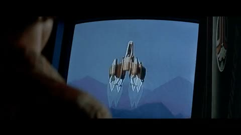
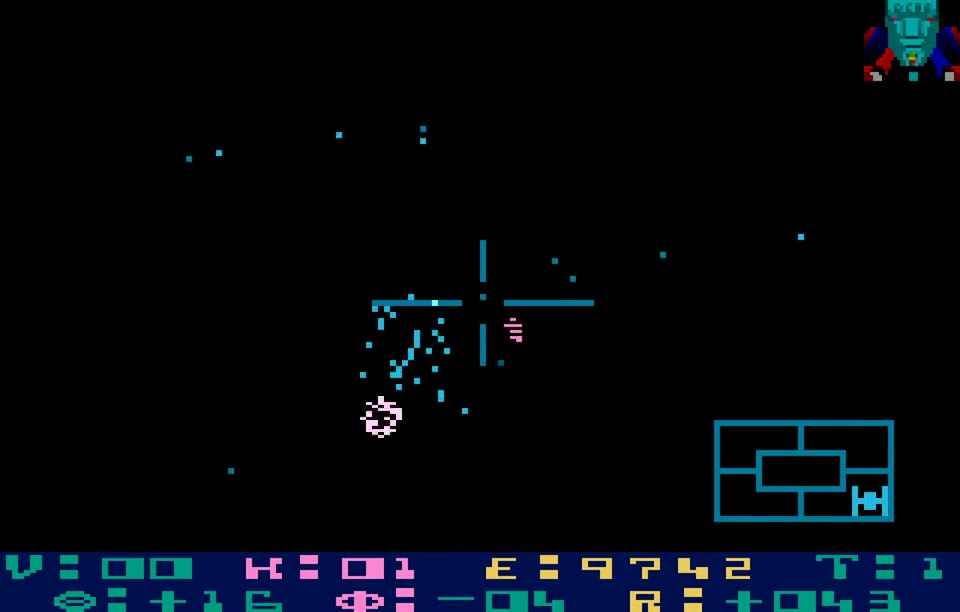
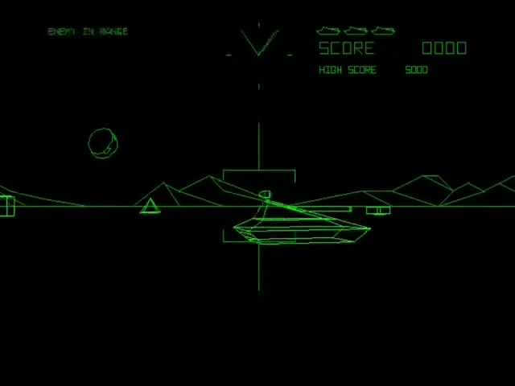
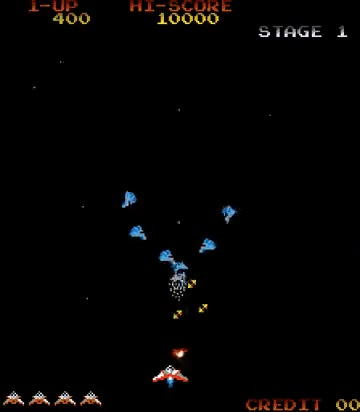
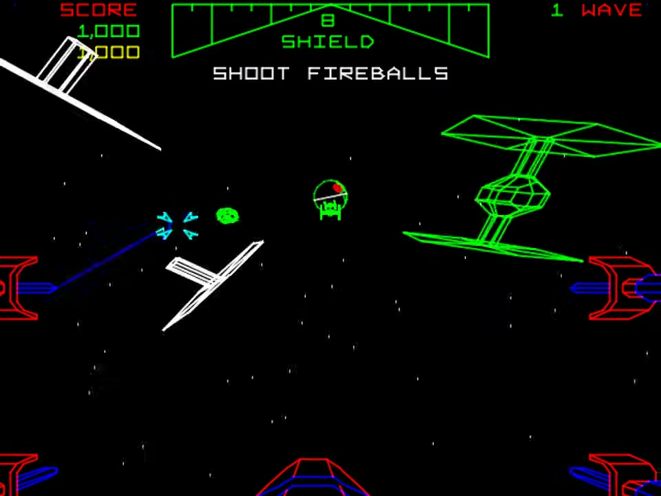
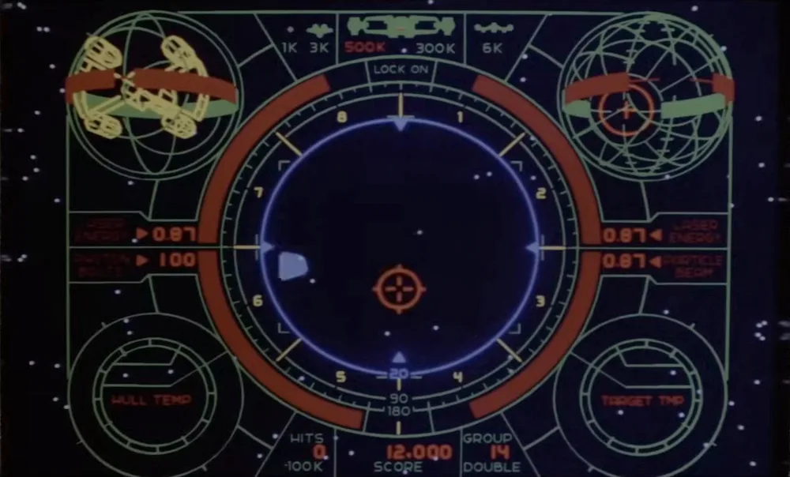
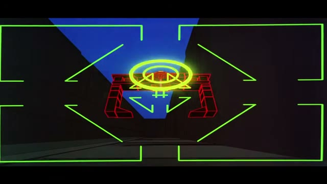

Let's talk about one of my favorite movies, The Last Starfighter. A fun movie from 1984 telling the tale of a trailer park kid who was so talented at a videogame that he was tapped to fight fascism in space using the same arcade controls to fly a supremely powerful spaceship. One gunstar vs the entire armada. Spoilers: they win!

Even that quick synopsis already points to some interestingly forward-thinking ideas like the rise of competitive e-sports. But I want to focus in on a different aspect of the movie: the arcade game itself.

Check out this clip of the in-movie "Starfighter" arcade game starting up.

<video loop muted playsinline controls preload="metadata" poster="starfighter-arcade.jpg" width="480" height="270" aria-label="The Starfighter arcade cabinet in The Last Starfighter (1984): its attract mode shows a ship over mountains, the camera swoops in close, and the screen becomes the green and orange first-person cockpit view">
  <source src="starfighter-arcade.mp4" type="video/mp4">
  
</video>

<small>Clip from *The Last Starfighter* (1984, Lorimar/Universal).</small>

In a few seconds we have several motifs that didn't even exist in videogames yet:

- a camera that moves through a 3D scene
- zooming in from a third-person overview to a first-person in-game perspective
- a HUD showing a complete interface to various ship systems and orientation in 3D space

The movie didn't invent all of this from nothing. There were already games putting players in a cockpit in 3D space. Star Raiders, from 1979 on Atari's home computers, had a crosshair, a row of ship readouts along the bottom (velocity, kills, energy, and the target's bearing and range), and an attack computer display in the corner that tracks the enemy you're aiming at.

<video loop muted playsinline controls preload="metadata" poster="star-raiders.jpg" width="480" height="306" aria-label="Star Raiders (Atari, 1979) on the Atari 800: a first-person view of space with a crosshair in the center, an attack computer display in the lower right that tracks the target, and a row of readouts along the bottom; enemy ships close in and explode, and the background turns dark blue as &quot;SHIELDS ON&quot; appears">
  <source src="star-raiders.mp4" type="video/mp4">
  
</video>

<small>Clip from *Star Raiders* (1979, Atari), from [Old Classic Retro Gaming's playthrough](https://www.youtube.com/watch?v=L8YdO6PYViw&t=51s).</small>

But no actual arcade or videogame was anywhere close to what they dreamed up as the Starfighter arcade game.

In 1980 Atari brought first-person 3D to arcades with Battlezone. You drive a tank across a green wireframe battlefield with a gunsight in the middle of the screen, and a radar at the top sweeps around to show enemies on every side of you.

<video loop muted playsinline controls preload="metadata" poster="battlezone.jpg" width="480" height="360" aria-label="Battlezone (Atari, 1980) arcade gameplay: a green wireframe first-person view across a plain with mountains on the horizon, a radar sweep and the score at the top, and a gunsight in the center; the player&#x27;s tank runs into a pyramid, then lines up an enemy tank and blows it apart">
  <source src="battlezone.mp4" type="video/mp4">
  
</video>

<small>Clip from *Battlezone* (1980, Atari), from [Shane McComas's video](https://www.youtube.com/watch?v=Ctr54kopo8I&t=6s).</small>

Here's Gyruss, a Konami game from 1983 that was in arcades while the movie was being made.

<video loop muted playsinline controls preload="metadata" poster="gyruss.jpg" width="360" height="412" aria-label="Gyruss (Konami, 1983) arcade gameplay: the player&#x27;s ship flies in along the bottom of a starfield as &quot;2 WARPS TO NEPTUNE&quot; appears, then a wave of blue enemy ships swirls in from the center and the ship fires up at them">
  <source src="gyruss.mp4" type="video/mp4">
  
</video>

<small>Clip from *Gyruss* (1983, Konami), from [Old Classic Retro Gaming's playthrough](https://www.youtube.com/watch?v=CrrMQBLqqVo&t=33s).</small>

All great games. Iconic, classic, very 1980s arcade. But nothing like what the movie's game was showing.

For 3D space games at the time the state of the art was Atari's Star Wars, also from 1983. It has real 3D ships and a cockpit view, but the ships are wireframe outlines, the camera is fixed to the cockpit, and the HUD is a shield gauge and a score. Nothing close to the cinematic design of the movie's Starfighter game.

<video loop muted playsinline controls preload="metadata" poster="star-wars.jpg" width="480" height="360" aria-label="Star Wars (Atari, 1983) arcade gameplay: after a &quot;Select a Death Star&quot; screen of three wireframe Death Stars, the view becomes an X-wing cockpit with a shield gauge at the top, and green wireframe TIE fighters and Darth Vader&#x27;s ship swoop past the targeting reticle as the player fires blue lasers">
  <source src="star-wars.mp4" type="video/mp4">
  
</video>

<small>Clip from *Star Wars* (1983, Atari), from [AL82 Retrogaming Longplays' longplay](https://www.youtube.com/watch?v=nJv94FPRddA&t=81s).</small>

Now let's zoom in on the Starfighter HUD.

<small>Still from *The Last Starfighter* (1984, Lorimar/Universal).</small>

Just look at the artistic beauty of that imagined videogame UI! Sure some games had some of those ideas already like a targeting reticle, power levels. But no actual game had put them all together so elegantly and also added 3D space specific visualizations like the ship model and 3D radar view. That's a lot of complexity to keep up with and it still reads intuitively like a game that you could actually play.

Speaking of actually playing, credit to Lance Guest for really conveying the sense that he's _actually_ playing a game that couldn't have existed. In even more recent movies and tv shows we're all too familiar with the "act like you're playing a videogame" trope that's just mashing buttons and wildly flipping the joystick. In The Last Starfighter the character Alex is playing with careful intent that's completely convincing.

How did they do it? Well from a technical level of course the Starfighter game never had to actually run on arcade hardware. The movie's effects were made by Digital Productions, the company John Whitney Jr. and Gary Demos founded, on a Cray X-MP supercomputer. That was around 25 minutes of computer graphics across nearly 300 shots. An actual arcade game has to draw a new frame many times a second, live. The movie's "game" could take as long as it needed on each frame, so it could show what a game would look like once the hardware caught up.

From a design standpoint I have no idea! I've searched for any kind of explanation and haven't found anything that goes into detail about the making of the movie arcade game concept itself.

So was the movie predicting where videogames were going, or showing them the way? I'd guess predicting, because I've never heard any game developer call out The Last Starfighter as a direct inspiration.

The Last Starfighter holds up when compared to other arcade movies of the time as well. TRON of course had Flynn's arcade showcasing the in-movie game Space Paranoids. But Space Paranoids is more like an enhanced version of Battlezone than an arcade game way ahead of its time.

<video loop muted playsinline controls preload="metadata" poster="space-paranoids.jpg" width="480" height="270" aria-label="Space Paranoids in TRON (1982): the game&#x27;s blue screen inside its cabinet bezel, Flynn playing in front of a watching crowd, then the full-screen view of green HUD brackets and a gunsight around a red wireframe Recognizer that Flynn locks onto with a yellow ring and blows apart">
  <source src="space-paranoids.mp4" type="video/mp4">
  
</video>

<small>Clip from *TRON* (1982, Walt Disney Productions), from [Iamthe80sguy2's upload](https://www.youtube.com/watch?v=6QWEcj7UXFs&t=98s).</small>

Every time I watch The Last Starfighter I'm impressed. The filmmakers clearly loved arcade games and managed to dream one up that would still hold up as a game today.

