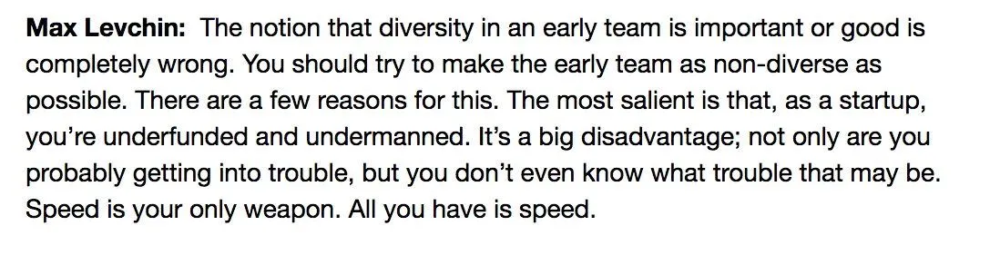

> Lack of diversity in tech is no accident.
>
> Peter Thiel, founder of PayPal, returned to his alma mater Stanford in 2012 to teach his now famous "CS183: Startups" course.
>
> Thiel invited PayPal co-founder Max Levchin to guest lecture and asked Levchin "How do you build culture?"
>
> 
>
> — Chad Loder ➐ (@chadloder) [October 19, 2019](https://twitter.com/chadloder/status/1185634274529009664)

# Excuses

There are refrains about diversity that can be heard all around the tech industry.

> We're looking for culture fit.
>
> I don't think they'd gel with the team.
>
> Diversity isn't a goal: it's a luxury we can afford later.

We can do better. We should do better. Our work would be better if we did better. We'd make more money if we did better.

## "We can't afford to be diverse yet"

Time and again companies optimize their hiring pipelines to select candidates that are like everyone else already at the company. I believe that's a mistake. A very costly mistake.

You might think I'm going to say it's a mistake to go against public perception. That the "cancel culture" will find out about the company's dark monoculture secret. But no. I believe ignoring diversity as a goal, especially in the early stages, is costly because it **directly costs money**.

Programmers are a focused bunch. When we're presented with a problem we want to solve it as quickly and effectively as we know how. Usually that means applying tech against the problem e.g. use a database for queryable persistent data, use a web framework to build an HTTP API, use a message queue to organize chunks of work. Or it can mean write some code: transform data from that API and then stuff it into another API, use an interpreted language to ensure a low effort and seamless transition between development and production machines, use a compiled language for speed and reduced deployment footprint. We want to solve the problem. We need to solve the probem.

The costly trouble is that when everyone thinks in the same way then, as an organization, they have blindspots. Even worse, they don't know they have blindspots.

Even if we grant they find the most amazing coders on the market. If the team all thinks immediately "Yes we need to do XYZ to solve **Problem A**" then we can assume they can very quickly code their XYZ. We can even assume that they do a pretty good job of coding XYZ from scratch.

But the time spent coding XYZ is time that wasn't spent coding anything else. No matter how good the coders are they are a finite resource. Time spent writing XYZ cost money. If someone could point out that they don't need to write XYZ at all, that Solution W already exists and fits neatly into the domain of **Problem A** then several things can happen.

- The team can take advantage of all the time already spent by the rest of the world on Solution W.
- The team can search the Internet for questions and information about using Solution W.
- The time that would have been spent coding XYZ can be spent writing a clean integration with Solution W.
- New members joining the team may come in with Solution W experience already.
- The team becomes part of a larger community of collaboration

Every one of those points adds up to more speed than brute force coding XYZ from scratch.

Diversity is the capacity for a team to think about alternatives. Diversity allows a team to fit into more problem domains by being less rigid and more agile. Diversity is a strength that startups can't ignore if they want to win their market.

Want to talk about speed? If speed is all you have then you can't afford to quickly write code that doesn't need to be written. No code is faster than no code. And no development process is faster than not developing in the first place.

As the good major said in _Ghost in the Shell_

> If we all reacted the same way, we'd be predictable, and there's always more than one way to view a situation. What's true for the group is also true for the individual. It's simple: overspecialize and you breed in weakness. It's slow death.

## "We'll add diversity later"

No one wants to be the odd person out. Now imagine being the odd person out in a group of fifty, or a hundred, or two hundred. It is far, far easier to build diversity into your team from the ground up than make a meaningfully diverse team "later". That's simple math.

For more on the flaws in this line of thinking please read through the wonderful _Parable of the Polygons_ by Vi Hart and Nicky Case.

By the time you think you can "afford" diversity it will be much more expensive to add it than if you had started with diversity as a goal.

## "It's not us... it's the pipeline"

Another common refrain in the tech industry is a kind of shocked reaction: it's not **us** it's the pipeline! Gosh we wish we could have a diverse team but candidates just aren't out there.

BS.

That line of thinking is a _direct_ result of blindspots. You only see candidates like the rest of your team because you're looking in the same places you found the rest of your team! That's like saying that you wish you could serve steak in your restaurant but no matter how hard you press your fishing teams they simply aren't catching any beef from the ocean.

# Diversity doesn't happen by itself

Diversity is not something that simply happen. Sure you'll get some diverse candidates through your monoculture pipeline and you'll think, "Well we're doing our best". But again that's flawed thinking. If your pipeline isn't full of qualified diverse candidates then you need to pivot, rethink your priorities, and put in the work to make it happen.

And, seriously, please read _Parable of the Polygons_.

Let's do better.
